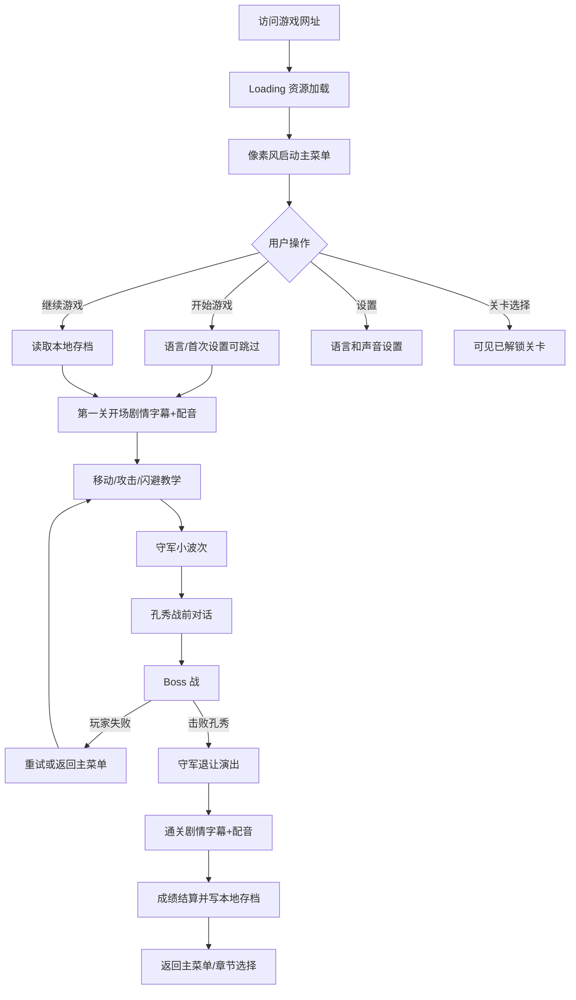

# Guan Gong: Five Passes — Web Game Product & Technical SPEC

**版本**：v1.1（2026-11-11）  
**状态**：第一阶段桌面优先的详细开发基准；第 19 节提供可执行的战斗数值与开发里程碑；第二至第五关仍待逐关迭代  
**项目名称（暂定）**：Guan Gong: Five Passes / 关公·过五关斩六将  
**主要交付**：可在浏览器访问的、以 `guangong_assets_06` HD-2D 美术为基础的原创剧情小游戏  
**开发优先级**：Phase 1 启动页 + 东岭关完整可玩 Demo；Phase 2–3 逐步追加内容及在线能力。

> **阅读顺序**：第 1–18 节定义总体产品与技术架构；**第 19 节为 Phase 1 东岭关的最新执行细则，若存在较旧模糊表述，以第 19 节为准。**

## 1. 产品愿景与设计原则

### 1.1 定位

面向全球玩家的轻量级 Web 游戏。以《三国演义》“过五关斩六将”的文学故事为主要叙事来源，以五段不同小游戏玩法串联“忠义、抉择、胆识、信任、坚持”的体验；让不熟悉三国文化的玩家也能在 10–30 分钟的完整游玩中理解基本故事（总时长为设计目标，需测试调整）。

### 1.2 非目标

不追求历史复原级严肃考据；不制作大型开放世界、多人实时对战、3D 自由视角、复杂 RPG 养成系统。不要照搬《星露谷物语》《泰拉瑞亚》《双刃战士》或《八方旅人2》的美术素材、地图布局、UI 或具体角色设计。参考仅为玩法类型与高层美术语言。

### 1.3 设计支柱

1. **风格统一**：五关使用已经通过评审的 `assets06` 美术视觉语言；小比例清晰像素人物 + 分层立体感场景 + 有节制的光影。
2. **玩法多样**：五个关卡采用不同互动方式，但统一菜单、文字、多语言、音频、存档、无障碍设置。
3. **低学习门槛**：第一关先学左右移动、攻击、躲避，明确的敌方攻击预警，死亡可以快速重试。
4. **叙事尊重**：故事源于《三国演义》文学叙述，不把小说桥段宣称为经证实的正史；必要时用可跳过的文化注释解释。
5. **轻量浏览器可访问**：免安装、免登录、可键盘游玩；首屏加载轻；后续优化触控体验。
6. **可扩展架构**：第一阶段先本地存档、无数据库；预留云存档和排行榜接口，而非过早建设后台。

## 2. 用户与平台

- 主要用户：国际学生、中文学习者、三国文化爱好者、一般小游戏玩家。
- 部署目标：公开 HTTPS 网址，可直接在 Chrome、Safari、Edge、Firefox 的现代版本打开。
- 初版游玩优先级：桌面/笔记本浏览器，横屏 16:9；兼容笔记本不同屏宽。
- 移动端：Phase 1 菜单适配手机且可正常浏览；触屏可玩作为优先争取的增强项，不在资源不足时牺牲桌面完成度。正式宣称移动端可玩前须实现与测试虚拟按键。
- 目标流畅度：常见笔记本 60 FPS（目标值而非保证），低端设备可降低特效。
- 隐私：Phase 1 不收集个人身份信息；本地存档只保存在玩家自己的浏览器中。

## 3. 分期与范围

| 阶段 | 必须交付 | 不包含 |
|---|---|---|
| **Phase 1（MVP）** | 原创像素风启动页、语言设置、音量设置、第一关剧情前后配音与字幕、东岭关清兵与孔秀 Boss、失败重试、通关存档、首章说明、Vercel 部署 | 其他四关完整实现；云端登录；公开排行榜 |
| **Phase 1.5（稳定性）** | 优化资源加载、触控方案（若可行）、可访问性、平衡、玩家测试、制作独立动画帧 | 全面账号系统 |
| **Phase 2（内容）** | 洛阳三车道跑酷、汜水关解谜、荥阳潜行、黄河渡口格挡与渡河，统一存档 | 实时多人联机 |
| **Phase 3（在线能力）** | 公开排行榜、可选登录、云存档与跨设备同步、反滥用措施 | 无法防作弊的伪“官方公平竞赛”声明 |

**阶段门槛**：只有 Phase 1 能够连续完成“打开网址 → 选择语言 → 开始 → 进入剧情 → 游玩 → 打 Boss → 结算 → 返回菜单并读取存档”后，才扩展下一章。

## 4. 世界观和章节规划

### Chapter 01：东岭关 Dongling Pass — 横版 Beat'em Up（Phase 1 必须完成）
- 小说对应：孔秀阻拦，要求检查通关文书；关羽拒绝留下二位夫人，击败孔秀，守军退让。
- **玩法**：侧视横版；左侧/前景的关羽，对阵从右侧靠近的守军和孔秀。先通过低压杂兵教学，随后触发 Boss。
- 玩家行为：左右移动、普通攻击、闪避；暂不要求复杂连招、装备系统或骑马控制。
- 教学顺序：移动提示 → 攻击提示 → 闪避提示 → 两小波守军 → 孔秀战前台词 → Boss 战。
- Boss 机制：至少两种可识别攻击（近身突刺、蓄力重击），攻击前有清楚预警；窗口允许玩家闪避/后退；可被攻击打断与击退，但不能永久锁死。
- **胜利演出**：击败孔秀后，普通士兵停止进攻、放下武器或跪拜/退让（呼应小说“众军俱拜于马前”）。不要求让每名守军逐个寻路逃跑，可用可控的短动画和过场实现。
- 失败：血量归零显示“重试 / 返回菜单”，不丢失以前通关状态。
- 结算：通关、时长、伤害次数、评价、是否解锁下一关（下一关功能尚未上线时标注“即将推出”，不能进入空白页面）。

### Chapter 02：洛阳 Luoyang — 三车道骑马跑酷（Phase 2）
- 孟坦佯败，韩福伏箭，关羽左臂中箭但继续闯关。
- 视觉参考：三车道跑酷的清晰可读性，不能拷贝《神庙逃亡》的关卡或 UI。
- 阶段 A：赤兔自动前进，左右键在三条车道切换、躲避鹿角拒马；追上孟坦后触发剧情攻击。
- 阶段 B：朝城门继续冲刺，韩福在远处射箭，玩家根据轨迹换道闪避；到城门触发击败韩福的过场。
- 需要连续性：关羽左臂负伤的剧情变体。

### Chapter 03：汜水关 Sishui Pass — 60 秒点击解谜 + 一次格挡（Phase 2）
- 卞喜假宴，普净示警，帷幕后有刀斧手，卞喜使用流星锤。
- 可交互线索：茶盏/杯垫（暗号）、异常端茶人（隐藏武器）、普净与戒刀/视线（帷幕后伏兵）。
- 解密：收集三条线索后才能触发揭露；卞喜举杯时按住他的手/点茶盏，再揭开帘幕；流星锤出现时按 Space 或点击格挡按钮。
- 计时约 60 秒，是提案值，可加入无时间限制的辅助模式。失败可以立即重试，不将随机点击作为唯一通关方式。

### Chapter 04：荥阳 Xingyang — 夜间潜行逃生（Phase 2，待玩法评审）
- 王植暗中准备纵火；胡班因父亲胡华的信示警并协助开门。
- 核心循环：发现阴谋 → 选择安全路线 → 躲避持火把巡逻兵的可见视野 → 护送同伴离开驿馆/城门。
- 以 2D 可视范围/安全区和少量定时交互构成，不引入完整复杂潜行 AI。
- 失败时从最近检查点重试；初期不做扩散火焰物理模拟，使用美术分层和触发器。

### Chapter 05：黄河渡口 Yellow River Crossing — 节奏格挡 + 渡河结局（Phase 2，待玩法评审）
- 秦琪阻拦渡河，关羽击败秦琪，护送二位夫人渡过黄河。
- 核心循环：短暂对话 → 观察秦琪出招节奏并及时格挡/反击 → 登船前检查行装或保护同行者 → 渡河演出。
- 避免与第一关完全相同的清兵玩法，将重点放在时机判断、故事完成感和最终场景。

> 所有章节内容均以小说为叙事基础；玩法细节、画面气氛和时长是游戏改编设计，需与中文课老师/团队评审。

## 5. Phase 1 详细用户流程



### 5.1 启动页

**风格方向**：借鉴《星露谷物语》《泰拉瑞亚》像素冒险的温暖启动页体验，但所有美术、字体排版、按钮和动画原创。不要照搬任一游戏的标题 logo 或按钮配置。

**必须具备**：
- 原创中英标题：关公·过五关斩六将 / Guan Gong: Five Passes（暂定）。
- HD-2D 原创远景（山路/关隘/云雾），分层或缓慢视差；按钮文字清晰。
- `开始游戏`、`继续游戏`（无存档时禁用并解释）、`关卡选择`、`设置`、`关于/文化说明`。
- 首次打开允许选择语言；以后记住设置。无需注册。
- 键盘、鼠标可操作；提供加载状态、静音开关、全屏开关（支持时）。
- 点击开始前不自动播放有声音频，必须经过用户操作后启动 Web Audio。
- 菜单背景和 Chapter 01 关卡的视觉身份一致。

### 5.2 开场剧情（首次进入/可重播）

- 2–4 个简短剧情镜头或文本卡：关羽得知刘备下落 → 带二位夫人出发 → 东岭关孔秀索取通关凭证 → 冲突将起。
- 每句字幕绑定 `lineId` 和可选音频；播放时显示说话人名，可重播、跳过。
- `继续` / `跳过` 不应导致音频叠加；必须正确停止前一个语音。
- 文化注释：“故事主要取材于《三国演义》，部分情节属于文学演义，而非已证实历史事件。”

### 5.3 战斗和教程

| 控件 | 键盘 | 触屏（可选） |
|---|---|---|
| 左右移动 | A/D 或 ←/→ | 虚拟左右方向 |
| 攻击 | J | 攻击按钮 |
| 闪避 | Space | 闪避按钮 |
| 暂停 | Esc / P | 暂停按钮 |
| 确认/交互 | Enter | 点击 |

- 第一版只有基础动作，避免复杂组合键。
- 角色状态：`idle`, `run`, `attack`, `dodge`, `hurt`, `defeated`, `victory`。
- 敌方状态：`idle`, `approach`, `telegraph`, `attack`, `hurt`, `defeated`, `retreat`。
- 攻击需设冷却、受击无敌短窗、碰撞和击退；具体数值可配置而非硬编码。
- 攻击视觉效果要清楚但不过量；禁用或减少屏幕震动的设置。
- 小兵的出怪数量、HP、Boss 伤害等由数据配置控制，方便课堂试玩后调平衡。
- 不要求 AI 生图的立绘直接承担所有动画：缺少动作帧时先制作最小可玩的占位动画并在素材追踪表注明待补，不要把游戏永久限制成静态图滑动。

### 5.4 通关与离开

- 击败孔秀 → 停止敌人攻击与生成 → 守军跪拜/退让短演出 → 通关字幕与语音 → 结算卡 → 自动保存。
- `返回主菜单` 按钮；设置和成绩更新保持。
- 玩家点击关卡中“退出”时弹确认框：进度可能从本关起点重玩；先暂停音频和战斗，再返回菜单。
- 准备对话与结尾对白都要有配音（按所选语言）。

## 6. 视觉与资产制作规范

### 6.1 已确定美术

唯一采用 `guangong_assets_06` 所确认的 HD-2D 方向：
- 像素人物可辨认，尤其是关羽红脸、黑长髯、绿袍、青龙偃月刀。
- 背景使用富有空间感的多层高质量插画，包含光束、雾气等轻量效果。
- 侧视横版第 1 关的摄像机不同于此前概念图的斜俯视：需要专门生成或裁切适合 side-scroller 的背景/平台/人物侧视像素素材。
- 概念 PNG 不能被视为完整游戏 Sprite Sheet，也不是可编辑 3D 模型；战斗需要可用于碰撞和帧动画的资源。
- 角色像素纹理尽量 `nearest-neighbor`，高清背景可以用 `linear` 平滑缩放，避免统一像素化造成 HD-2D 层次损失。
- 不需要 Blender；正式游戏使用 2D Sprite + 分层背景（视觉上呈现 HD-2D 效果）。

### 6.2 Phase 1 必要资源清单

| 类型 | 资源 | 要求 |
|---|---|---|
| UI | 标题 logo、按钮态、面板、选择光标、加载图 | 原创像素风，易于英文和拼音排版 |
| 玩家 | 关羽 Sprite Sheet | 站立、跑动、攻击、闪避、受伤、倒地/胜利；透明背景，统一帧尺寸、锚点 |
| NPC | 孔秀 Sprite Sheet | 站立、突刺、蓄力、受伤、倒下 |
| 敌人 | 普通守军 Sprite Sheet | 行走、攻击、受伤、退让/跪拜 |
| 武器/VFX | 青龙偃月刀、长枪、挥砍效果、命中火花 | Sprite 或可分层图片 |
| 场景 | 东岭关横版可重复背景、前景、关门、城墙、道路 | 和原有 `assets06` 设定一致；至少 2–3 视差层 |
| 叙事 | 开场/结尾剧情图、角色小头像、文化注释图 | 可以复用已有 HD-2D 概念图 |
| 音频 | 中文开场/结尾、英文开场/结尾、互动语音、BGM、SFX | 音频 ID 与字幕 ID 对齐；可静音、可重播 |

**资源交付要求**：需要透明像素人物和可用动作帧；如果素材正在批量 AI 生成，先自动做资产审计，列出可直接使用、需抠图、需补侧视、需补动画四类。尽量保留 `guangong_assets_06` 原图库，在游戏工程中只引用/复制经批准和优化后的运行时资源。

### 6.3 推荐资源规范

- 源图：PNG；运行时音频：优先压缩为 OGG/MP3 并测试 Safari 兼容；可留 WAV 源文件用于编辑。
- 场景：16:9；第一阶段逻辑画布建议 960×540，使用自适应 FIT 缩放，按实际像素素材分辨率调整。
- PNG Sprite 需透明 alpha，不得把纯白底伪装透明；尺寸/帧序固定。
- 所有文件采用英文路径与语义化文件名；禁止把整套高清设计图无差别加载到第一关。
- 加载策略：先加载菜单轻量资源，点击开始时按关卡加载对应图片和音频；保持合理的单次下载体积。
- 图片和音频应有许可证/来源记录，尤其是 AI 生图、外部字体和音乐素材。

## 7. 四种语言与语音

### 7.1 语言选项

| UI 名称 | locale | 文字 | 配音 |
|---|---|---|---|
| 简体中文 | `zh-Hans` | 简体中文 | 普通话 |
| 繁體中文 | `zh-Hant` | 繁體中文 | 普通话（第一版） |
| English | `en` | 英文 | 英语 |
| Pīnyīn / 拼音 | `zh-Latn-pinyin` | 带声调汉语拼音（必要处可附汉字） | 普通话 |

**澄清**：拼音是文字转写方式，不是单独一种配音语言。简体、繁体和拼音可共享同一套普通话音轨；英文需要独立的英文配音。繁体的粤语配音可作为未来可选包，而非默认假定。

### 7.2 结构与流程

- 所有游戏 UI、菜单、教学、剧情对白、文化注释必须从同一套 `lineId` / `translationKey` 读取，不允许在 Phaser Scene 里硬编码中文字幕。
- 文本按 locale 分为 JSON 或 TS 资源文件。拼音需人工核对多音字/专名声调；不直接在运行时把英文或繁体机翻成拼音。
- 音频命名示例：`audio/voice/zh/ch01_intro_001.ogg`、`audio/voice/en/ch01_intro_001.ogg`。
- 音轨切换发生时，立即停止之前语言的当前语音；字幕和语音切换同步。
- 语言可在主菜单设置里随时切换，切回游戏不重置进度。
- 字幕必须可见，允许单独关闭配音、调整语音/BGM/SFX 三种音量。
- 音频许可：如果使用 TTS/生成语音，需检查服务条款和使用许可；不要模仿未经授权真人的声线。

### 7.3 配音触发点（Phase 1）

1. 用户点击开始游戏后，播放开场叙事（多句）。
2. 孔秀出场，进行战前对白。
3. 教学提示可选短语音，至少必须有可读文字。
4. 孔秀败退/守军跪拜后，播放通关旁白与关羽的回应。
5. 退出确认弹窗在第一版可保持文字，不要求每个菜单按钮都配音。

## 8. 存档设计

### 8.1 Phase 1：仅本地保存

使用 `localStorage`（可迁移到 IndexedDB 或云存档），存储轻量 JSON。不存音频、图片。

示例结构：

```json
{
  "schemaVersion": 1,
  "saveId": "local-main",
  "settings": {
    "locale": "zh-Hans",
    "voiceVolume": 0.8,
    "musicVolume": 0.55,
    "sfxVolume": 0.8,
    "reducedMotion": false
  },
  "unlockedChapter": 1,
  "chapters": {
    "1": {"cleared": false, "bestScore": null, "bestTimeMs": null, "completedAt": null}
  },
  "updatedAt": "2026-11-11T00:00:00.000Z"
}
```

- `schemaVersion` 必须保留，以便未来添加字段时迁移。
- 存档损坏时回退安全默认值并提示，不直接崩溃。
- 浏览器隐私模式/清理数据可能导致丢失，UI 必须告知。
- 自动存档点：设置改变、通关结算、重要剧情完成；不要每帧调用。
- “继续游戏”只跳转已开放且解锁的关卡；尚未开发的章节显示 Coming Soon。

### 8.2 Phase 3：云存档（可选）

- 若需要跨设备恢复，添加账号绑定/登录；匿名身份不等于可靠跨设备账号。
- 后端保存用户 ID、章节成绩、保存版本、更新时间；迁移本地数据时由用户确认且避免覆盖更新版本。
- 优先 Supabase Auth + Postgres + Row Level Security (RLS)。

## 9. 排行榜计划（暂不在 MVP 实现）

### 9.1 排名维度

- 每关独立排行榜。推荐展示 `score`、`rank` 和用于打破平分的 `time`。
- 五关全部上线后再考虑综合排行榜（各关分数先标准化到同一区间，不能直接加总毫不相关的原始计数）。
- 玩家可用昵称；需基本昵称长度、敏感文本过滤和举报/移除机制。

### 9.2 评分草案

- Chapter 1：通关 + 剩余血量 + 受击次数 + 用时，未来可加入组合攻击表现。
- Chapter 2：碰撞/箭矢命中次数 + 时间与完成状态。
- Chapter 3：正确线索 + 提示次数 + 完成时间。
- Chapter 4：被发现次数 + 安全逃离 + 用时。
- Chapter 5：格挡成功率 + 登船任务成功 + 完成时间。

**暂不固定精确公式**，先在本地记录原始指标并通过试玩确定合理权重与最高分，再开放全球排名。

### 9.3 公共榜的安全原则

- 前端分数不可信；禁止任何匿名客户端直接任意更新全局 leaderboard 表。
- 推荐 Vercel Serverless API/Functions 接收完成记录，校验身份、会话、合理时长、规则版本和提交频率，再由服务端写入 Supabase。
- 以上只可防止低成本滥用，**不能完全防止修改客户端/伪造操作**；若排名具有奖品或重要公信力要求，需要服务器权威运行或可验证 replay。
- 账号/数据库只能在 Phase 3 开通；表和路由可预先设计接口但不得阻碍 MVP 运行。

## 10. 技术架构与选择

### 10.1 选定方案

- **Vite + React + TypeScript**：Web 壳层、主菜单、设置、语言、字幕层、加载/错误 UI。
- **Phaser 3.x（建议 3.90 系列，开工时锁定实际兼容版本）**：2D 玩法、场景、输入、动画、碰撞、镜头、音效。若团队改用 Phaser 4，须先验证 API 和资源管线，避免混用版本示例。
- **Tailwind CSS**：Web UI 的响应式布局与统一设计 Token。
- **i18next**：翻译键与语言切换（可使用 typed JSON loader）。
- **Vercel static hosting**：Phase 1 由 Vite build 输出静态资源，无常驻 Node 服务器、无数据库。
- **Supabase（可选 Phase 3）**：身份认证 + PostgreSQL + RLS。
- **Vercel Functions（可选 Phase 3）**：用于验证和写入排行榜/云存档的安全 API；不是游戏帧循环所在位置。

### 10.2 架构职责

```
Browser (React shell)
  ├─ Main Menu / Settings / i18n / Subtitles / Accessibility
  ├─ Phaser Game Canvas
  │   ├─ Boot/Preload
  │   ├─ Chapter01 Scene (later 02...05)
  │   ├─ Combat & Input & Camera
  │   ├─ Dialog/Event timeline
  │   └─ Scene Transition
  ├─ AudioService (voice / music / sfx)
  ├─ SaveRepository interface
  │   └─ LocalSaveRepository (MVP)
  └─ LeaderboardRepository interface (future)
      └─ Remote API client (Phase 3)
           ↓ HTTPS
         Vercel Functions (Phase 3)
           ↓
         Supabase Auth/Postgres (Phase 3)
```

- React 与 Phaser 通过受限 event bridge 交换 `startChapter`, `pause`, `chapterCleared`, `gameOver`, `languageChanged` 等事件；避免两套系统双向不断重绘。
- Phaser 管理即时游戏状态；React 管理菜单、长期设置和 overlay。只有一个存档服务写本地数据。
- 所有关卡通过明确 `ChapterDefinition` 配置注册，避免将五种玩法写进一个超大 Scene。

### 10.3 为什么不是直接用 Next.js？

MVP 是完全客户端执行的 2D 小游戏，Vite 静态构建更简单、加载路径更直接、可以直接部署 Vercel。若未来确实需要 SSR/SEO 页面和大量服务端路由，再评估 Next.js；**不用为了后端可能性现在就引入 Next.js**。

## 11. 建议代码组织

```text
GuanGongWebGame/
├── SPEC.md
├── README.md
├── package.json
├── vite.config.ts
├── src/
│   ├── app/                  # React 入口、路由及布局
│   ├── ui/                   # PixelMenu、Settings、DialogOverlay、Results
│   ├── game/
│   │   ├── main.ts           # Phaser bootstrap
│   │   ├── scenes/           # Boot, Preload, Chapter01, Result
│   │   ├── entities/         # Player, Guard, KongXiu
│   │   ├── systems/          # Combat, Input, Spawning, Camera, Events
│   │   ├── chapters/         # 章节配置与未来关卡
│   │   └── bridge/           # Phaser <-> React typed events
│   ├── data/                 # 对话、故事、关卡平衡参数
│   ├── i18n/                 # zh-Hans, zh-Hant, en, zh-Latn-pinyin
│   ├── services/             # SaveRepository, AudioService
│   ├── styles/
│   └── types/
├── public/
│   └── game-assets/
│       ├── ui/
│       ├── shared/
│       ├── chapter01/
│       │   ├── sprites/
│       │   ├── backgrounds/
│       │   ├── story/
│       │   ├── audio/
│       │   └── manifests/
│       └── fonts/
├── tools/                    # 图片审计、sprite sheet 构建脚本
├── docs/                     # 美术来源、文化核对、可访问性
└── tests/
```

注意 `guangong_assets_06/` 为上游美术仓库/目录，**不应把所有未优化概念 PNG 原样塞到运行时 public/**；可通过 manifest 记录来源并筛选游戏需要的文件。

## 12. 开发体验、性能与音频

- 所有章节单独资源包，运行时按需加载；加载失败有 Retry 按钮。
- Phaser 内部游戏循环应运行在浏览器端，**绝不通过 Vercel Function 逐帧处理**。
- 音频首先由用户交互激活，处理自动播放阻止的情况；暂停/离开关卡时停止对应对白，避免叠音。
- Voice、BGM、SFX 各自独立音量设置并保留静音。
- 音效、字体与图像都应在有限流量下可加载；提供轻量模式（降低雾、景深、粒子与过场效果）。
- 使用真实加载进度，不显示假的百分比。
- 基础可访问性：字幕默认开启、足够对比度、可键盘完整操作、可关闭屏幕震动。
- 游戏窗口 Resize 时正确缩放，而不是拉伸角色造成变形。

## 13. 数据结构 / API 预留

**Phase 1：仅内部接口，无实际云端请求。**

```ts
type Locale = 'zh-Hans' | 'zh-Hant' | 'en' | 'zh-Latn-pinyin';
type ChapterId = 1 | 2 | 3 | 4 | 5;

interface ChapterResult {
  chapterId: ChapterId;
  completed: boolean;
  durationMs: number;
  damageTaken: number;
  hitsTaken: number;
  score?: number;
  scoreVersion: string;
}

interface SaveRepository {
  read(): Promise<GameSave>;
  write(save: GameSave): Promise<void>;
}

interface LeaderboardRepository {
  list(chapter: ChapterId): Promise<LeaderboardEntry[]>;
  submit(result: ChapterResult): Promise<void>;
}
```

Phase 3 可以考虑 `POST /api/runs/start`, `POST /api/runs/finish`, `GET /api/leaderboard?chapter=1` 等路由；但只有设计文档和 stub，不要先构建假后端。

## 14. 第一阶段验收标准（Acceptance Criteria）

| ID | 可验证的条件 | 优先级 |
|---|---|---|
| AC-01 | Vercel 提供 HTTPS 网址；首次打开不要求登录，也不出现运行时错误 | P0 |
| AC-02 | 原创像素风启动页完整显示并可用键盘、鼠标操作 | P0 |
| AC-03 | 可以切换四种文字模式；主菜单、教程、故事字幕全部切换正确 | P0 |
| AC-04 | 中文（含拼音/繁体模式）播放普通话配音，英文模式播放英语配音；可关闭和调音量 | P0 |
| AC-05 | 开始游戏后正确播放开场剧情并可跳过；游戏开始后不叠加前一段配音 | P0 |
| AC-06 | A/D 或左右方向移动、J 攻击、Space 闪避、Esc 暂停；有清晰教程 | P0 |
| AC-07 | 玩家能击败至少两波普通守军，再与孔秀 Boss 交战 | P0 |
| AC-08 | Boss 具有至少两种带明确预警的攻击；可以成功躲避与反击 | P0 |
| AC-09 | 击败孔秀后所有杂兵停止攻击，并播放跪拜/退让演出 | P0 |
| AC-10 | 通关字幕与语音正常播放，随后出现结算界面 | P0 |
| AC-11 | `localStorage` 保存首章完成状态、最佳成绩、语言和音量；刷新页面后仍存在 | P0 |
| AC-12 | “继续游戏”只在已有存档时可用；未实现关卡显示“即将推出” | P0 |
| AC-13 | 关卡失败可重试或返回菜单，不能卡死或失去输入 | P0 |
| AC-14 | 文学改编声明在“关于”或章节文化注释中可见，中英文翻译准确 | P0 |
| AC-15 | 无失效的美术/音频路径，PNG 动画清晰且人物、背景呈现 06 号视觉语言 | P0 |
| AC-16 | 同一套建构在常见桌面 Chrome、Safari 上能启动和游玩 | P0 |
| AC-17 | 小屏手机菜单不会溢出，触屏战斗若未完成须清晰提示“建议桌面游玩” | P1 |
| AC-18 | 可选轻量模式、触屏虚拟按键与辅助解谜设置 | P1 |

## 15. 测试计划

1. 首次访问：英文浏览器、中文浏览器；无存档、无语言配置。
2. 输入：键盘、鼠标、窗口失焦、游戏暂停、切换标签页。
3. 战斗：多次攻击、连续闪避、同时敌人攻击、玩家死亡、Boss 死亡时小兵还在场。
4. 音频：浏览器阻止自动播放、快速跳过剧情、反复切语言、静音开关、Safari 可播放格式。
5. 存档：刷新、关闭重开、损坏/不兼容旧版存档、隐私模式。
6. 画面：不同桌面分辨率；背景与 Sprite 采样方式；检查小字号英文字和拼音的排版。
7. 发布：构建成功、未在静态包中暴露未来服务端密钥、404/资源路径正确。

## 16. 待团队确定的产品决定

1. 游戏英文正式名称、Logo 字体及英文副标题。
2. 第一关每波兵数量、Boss HP、玩家 HP、评分公式（由试玩决定）。
3. 角色动作制作方式与质量要求（AI 生成动作帧、手工像素修图或简易骨骼效果）。
4. 全五关完成目标时间，以及每关失败时的容错程度。
5. 手机触屏操控是否必须在第一次课堂展示前上线。
6. 是否提供剧情“简短/完整”两种模式，以及是否需要文化图鉴。
7. 排行榜是否公开、是否要求登录、是否涉及奖励（会影响防作弊架构）。

**开发不应因这些未决问题停滞**：采用上述 MVP 默认方案，参数保持可配置，评审后再修改。

## 17. Codex 第一阶段实现指令摘要

- 先 inspect 现有仓库和 `guangong_assets_06`，不要覆盖已有设计和素材。
- 若现有工程是空的，搭建 Vite + React + TypeScript + Phaser 3 + Tailwind + i18next。
- 实现原创启动页与 Phase 1 第一关完整闭环，优先保证可玩、可保存、可重试、四文字模式和中英配音对接。
- 先对现有 asset 做 audit；发现缺少可用动画帧则生成 `ASSET_GAPS.md`，使用明确标注的临时运行时资源继续构建玩法，不要伪称 AI 概念图就是 sprite sheet。
- 使用模块化章节设计，为后四关保留 chapter scene/config 接口；不要实现后四关空壳的假按钮。
- 本阶段不能添加 Supabase、数据库 schema、登录或排行榜 API，除非用户明确要求。
- 完成 build、基本测试，并在 README 中记录启动、部署方式和不能验证的事项。

## 18. 资料与技术核对

- Phaser：<https://www.phaser.io/oss/docs/>
- Phaser 音频：<https://docs.phaser.io/phaser/concepts/audio>
- Vercel 静态托管与 Functions：<https://vercel.com/docs/functions/limitations>
- Vercel 外部数据库：<https://vercel.com/docs/postgres>
- Supabase 匿名登录：<https://supabase.com/docs/guides/auth/auth-anonymous>
- 浏览器自动播放策略：<https://developer.mozilla.org/en-US/docs/Web/Media/Guides/Autoplay>

---

**SPEC 结论**：先以无后端的 Vercel 静态 Web 游戏完成第一关；后端不是“能玩”的前提，数据库是“多人共享持久数据”的需要。第一阶段只完成高质量、可试玩、可重复发布的东岭关 MVP。后四关按各自的互动机制逐关开发，公共排行和云存档再单独立项。
---

## 19. v1.1 第一关开发细化（优先于本文件较早的第一关模糊描述）

**实施决策（2026-11-11）**：第一阶段 **Desktop-first**，仅做启动页与第一关东岭关的可玩闭环；Phaser 3.90.0 为优先验证的版本（先核查现有工程依赖，不强行降级已有可用版本）。以下均为**首次试玩的默认可调数值**，不是对正式玩法的承诺。

### 19.1 设计目标与非目标

**目标体验**：玩家在前 60–90 秒掌握操作；前两波守军攻击简单、有清晰打击反馈，产生“砍瓜切菜”的爽快感；随后孔秀以明显前摇的长枪攻击教会玩家闪避、观察破绽和反击；胜利后余下守军退让，保持《三国演义》叙事方向。

- 目标时长：首次游玩 6–9 分钟；熟练玩家约 3–5 分钟（非强制计时）。
- 横版 **单条地面战斗平面**，只需要左右移动，不引入跳跃、Y 轴自由走位、平台解谜、复杂技能/道具、骑马系统。
- 无多人、排行榜、账号、服务器和数据库；第一阶段成绩只保存在本地。
- 关羽、孔秀、士兵全程保持已选 06 号 HD-2D 身份。概念图不等于动作素材，允许开发期明确标记的临时动画，但发布验收必须记录/修复残余缺口。
- 家眷和马车在前后景中作为可见叙事要素，不需要被复杂 AI 逐帧护送，也不设置容易造成玩法挫败的马车血条。

### 19.2 关卡流程与演出状态机

| 编号 | 状态 | 目标持续 | 用户行为 | 状态转移条件 |
|---|---|---:|---|---|
| F00 | `TITLE` / `SETTINGS` | 自由 | 选择简中、繁中、英文、拼音及音量；开始/继续 | 点击「开始」或合法继续 |
| F01 | `INTRO_CUTSCENE` | 45–70s，可跳 | 旁白 + 2–4 幕剧情文字/场景；可逐句继续、重播、跳过 | 台词结束或跳过 |
| F02 | `TUTORIAL_MOVE` | 10–15s | A/D 或左右移动至旗标 | 到达旗标 |
| F03 | `TUTORIAL_ATTACK` | 15–20s | J 斩断木桩 / 击中训练靶；不用敌人威胁 | 完成 2 次有效攻击 |
| F04 | `TUTORIAL_DODGE` | 15–20s | Space 躲过可预见的示范突刺 | 成功一次闪避，或经可访问性提示后完成 |
| F05 | `GUARD_WAVE_1` | 30–45s | 面对 2 名单体守军，建立轻松节奏 | 两人倒地/退出战斗 |
| F06 | `GUARD_WAVE_2` | 45–75s | 面对 3 名守军，逐步学习移动-攻击-闪避 | 两波全部清除且走至关门触发区 |
| F07 | `BOSS_DIALOG` | 20–35s，可跳 | 孔秀索要通关文书，关羽拒绝留下二位夫人；配音字幕 | 对话完成或跳过 |
| F08 | `BOSS_FIGHT` | 60–120s | 孔秀长枪突刺、横扫；下半血增加连招 | 孔秀 HP<=0 或关羽 HP<=0 |
| F09 | `VICTORY_CUTSCENE` | 20–40s，可跳 | 孔秀倒下；其余守军放下武器、跪拜/退让；出口打开 | 演出完成或跳过 |
| F10 | `OUTRO_AND_RESULT` | 25–50s，可跳 | 旁白说明继续寻兄，显示评分、时间、受击、保存状态 | 用户选择返回菜单/重玩 |
| ERR | `DEFEAT` | 自由 | 重试（从教学完成后的第一波开始，或选择重做教学）/返回主页 | 重试或退出 |

**切换规则**：进入过场时冻结所有敌人、取消尚未生效的攻击 hitbox、停止移动输入；切换场景/跳过时停止上一句旁白；返回主菜单后不再有隐藏运行的 Phaser 场景或音频。

**退出**：在暂停菜单选择「退出关卡」先弹确认，支持简中/繁中/英/拼音字幕，可配置中英文短语音；确认后停止游戏计时与音频并返回菜单。玩家未通关的本轮战斗不保存为已完成。设置继续保留。

### 19.3 场景布局：2D 可滚动世界 + HD-2D 视效

- 设计坐标：逻辑画布 `960×540`，横屏 16:9；使用 Phaser Scale FIT，维护游戏内坐标与输入区域一致；屏幕变动时不能拉伸角色。
- 世界宽度**初稿** 3400 逻辑像素，高度 540；四个区域依次大致是 `0–800` 教学、`800–1650` 守军 1、`1650–2400` 守军 2、`2400–3400` 城门及 Boss。具体边界由实际资源尺寸和试玩调整。
- 战斗主体地面为单条二维线/带，角色不跳跃；`y` 为统一足底基准。用远山、城墙、树木等 2–3 个横向视差背景层制造 HD-2D 空间感，前景装饰需避免遮挡交战区域。
- 摄像机在移动时平滑跟随关羽，Boss 战将镜头限制在城门竞技区域。进入下一波前，以无形 soft gate 保证敌人/剧情正常加载，而不是永久隐形墙。
- UI 安全区：顶部左为 6 格心形 HP，顶部右为暂停，战斗区域上方可放孔秀 HP；移动教程位于画面不挡人的角落。
- 角色 Sprite 保持 crisp nearest-neighbor（整数缩放优先）；高分辨率背景可线性过滤。光束、景深、雾只作为轻量叠层，不应用整图模糊遮住角色。
- 移动端本阶段只要求菜单不溢出，进入战斗时显示「建议使用桌面键盘」；不要误称已支持手机战斗。

### 19.4 键位、输入优先级和操作手感

| 操作 | 键位 | 实现细节 |
|---|---|---|
| 水平移动 | `A`,`D` 或 `←`,`→` | 按住连续移动；攻击时可有限减速；不能越过场景边界 |
| 攻击/接连段 | `J` | 单次触发一段；在接段窗口再按最多追加到 3 段；按住 J 不应自动无限连击 |
| 闪避 | `Space` | 朝面向方向/当前水平输入方向短距离位移；有冷却和短暂无敌窗口 |
| 互动/推进对白 | `Enter` | 用于剧情继续与关门交互，战斗时不触发额外攻击 |
| 暂停/恢复 | `Esc` 或 `P` | 暂停物理、AI、计时、语音可暂停；失去焦点时自动暂停 |
| 文本显示/跳过 | UI 按钮或 `Enter` | 台词播放顺序必须与音频同步，不出现重复触发 |

**输入优先级**：过场/暂停/失败状态下，战斗键不触发攻击；倒地时不接受移动；闪避期间暂禁普通攻击以维持清晰反馈。需要 `justDown`/输入缓冲防止按键抖动导致多次攻击。

### 19.5 关羽 Player 设计（数值均可在 `ch01Balance.ts` 调整）

| 属性 | 初始默认 | 目的 |
|---|---:|---|
| 最大 HP | 6 hearts | 直观容错 |
| 水平移动 | 215 px/s | 容易控制 |
| 普通守军所受伤害 | 每段 1 | 杂兵 2 次命中结束 |
| 攻击连段 | 3 段（按 J 的节奏接续） | 形成手感，不加复杂技能树 |
| 连段起手/生效/后摇 | 100/120/150 ms（第一击） | 可读反馈，实际以动画对齐 |
| 连段伤害 | 1/1/2（Boss 每击需遵守 hit-once 规则） | 第三段更有成就感；若过强再调 |
| 受击后无敌 | 800 ms | 防止一瞬被多个敌人重叠秒杀 |
| 闪避总长 | 360 ms | 位移和短暂不可攻击 |
| 闪避无敌 | 220 ms（中间时间段） | 鼓励观察时机 |
| 闪避冷却 | 800 ms（从动作开始计算） | 避免反复无脑冲刺 |
| 受击击退 | 80 px / 短动量 | 清晰反馈 |

- 攻击范围由**面向方向上的短矩形 hitbox** 控制，而不是用美术图外边缘做真实判定。判定框独立于 hurtbox，便于从概念图改为动作图。
- 单次挥砍对同一敌人只命中一次。伤害、硬直和受击反馈必须有独立时间窗口，避免浏览器高刷新率导致多次伤害。
- 第三段伤害较高，但连段并非通关必需；单次连续按 J 也能赢，只是略慢。
- 受击反馈：短闪烁（不要依赖红色唯一提示）、轻微击退、音效、短时 hit-stop；默认降低屏幕震动，并尊重 reduced-motion 设置。

### 19.6 普通守军 Guard 行为

**Wave 1**：2 人依次靠近，攻击前摇较长，避免两个同时攻击。**Wave 2**：3 人，其中最多同时允许 2 人近身进入进攻准备，避免全员围攻；每人 HP 2，攻击伤害 1。

状态机：

`IDLE → APPROACH → TELEGRAPH → ATTACK_ACTIVE → RECOVERY → APPROACH`；受击可转 `HURT`；`HP <= 0 → DEFEATED`；孔秀战败/撤退命令可转 `RETREAT/KNEEL`。

| 参数 | 初始默认 |
|---|---:|
| 守军 HP | 2 |
| 守军伤害 | 1 |
| 移动速度 | 90 px/s |
| 攻击前摇 | 600 ms |
| 攻击命中窗口 | 160 ms |
| 攻击后摇 | 650 ms |
| 下一次主动攻击间隔 | 900–1400 ms |
| 受击硬直 | 250 ms |

- 抵达攻击距离才触发预警；守军举枪/小弧形提示至少 500ms。让玩家看到攻击来自哪边，而不是从屏幕外被偷袭。
- **场景守军**与**已倒地守军**区分：Boss 竞技场保留 1–2 个观望/守门士兵（默认非进攻型），以便 Boss 死后有可见的跪拜/退让演出。
- 如果 Boss 战时仍有活跃守军，Boss 败北事件必须取消其伤害判定并触发 `RETREAT`；不要要求玩家击倒所有守军才能通关。
- 无无限刷怪、无随机掉落、无经验系统。

### 19.7 孔秀 Boss 设计

**形象**：与第一关 assets06 设定一致的将领，持长枪；主要是第一次的“读招练习”而非高难度 Boss。

- 最大 HP：16；Boss HP <= 8 时进入二阶段。
- Boss 接近速度：110 px/s；攻击伤害 1 heart，接段每次分别判定但不得同一 hitbox 多次伤害。
- 状态机：`INTRO → IDLE/APPROACH → TELEGRAPH → ATTACK_ACTIVE → RECOVERY → HURT → (循环) → DEFEATED`。 `HURT` 只能在允许硬直的窗口中打断动作；防止玩家一直连按造成永久 stunlock。
- Boss 战设置 **可读攻击前摇**：角色蓄力姿势 + 枪尖发光/地面方向性提示 + 短音效。不要仅靠颜色提示；Reduced Motion 时仍清楚。

| 招式 | 第一阶段（HP>8） | 第二阶段（HP<=8） | 应对 |
|---|---|---|---|
| 直线突刺 `SPEAR_THRUST` | 前摇 650ms、命中 180ms、后摇 800ms | 前摇 550ms、其他基本一致 | 后撤/Space 闪避，趁后摇反击 |
| 大范围横扫 `SPEAR_SWEEP` | 前摇 900ms、命中 240ms、后摇 1000ms | 前摇 780ms | 看枪身抬起后闪避；范围更广 |
| 突刺→横扫 `COMBO` | 不出现 | 第二阶段每 3 次出招中最多 1 次 | 连续读招；两次判定之间保留至少 450ms 可识别间隔 |

**Boss 行为规则**：

1. 按距离选择招式，随机性可控、可测试；避免无法闪避的同时判定。
2. 单次攻击结束后必须有可反击的后摇窗口，至少约 650ms；反击时可减少 Boss HP。
3. 连段打中 Boss 时可短暂停顿，但受击硬直与免疫窗口限制无限僵直。
4. 玩家在 Boss 战开始时至少有 4/6 HP（如不足，补至 4，不超过上限），降低新手因教学误伤而直接失败的概率；UI 给出轻微提示，不凭空增加道具。
5. 击败孔秀立即锁定胜利状态；禁用残余 hitbox、结束攻击/AI/timer，不允许出现 Boss HP=0 但玩家随后死亡的竞态。
6. Boss 有独立的血条、受击提示和音效，不要求复杂技能特效、浮空与处决动画。

### 19.8 失败、重试、胜利演出

- 玩家 HP<=0：进入 `DEFEAT`，停止所有敌人 AI 与音效队列，保留可见失败界面。可选「重试战斗」「重做教程」「回主菜单」。
- 默认重试从守军 Wave 1 开始，不重复看开场剧情；教程完成标志仅记在当前会话或存档中（切换关卡可重新显示教程入口）。
- 当 Boss HP<=0：击败动画 → 残余士兵立即停止攻击→ 跪拜、放下武器或退让；青龙偃月刀收起→ 出口打开/马车继续前行→ 结束对白。
- 若缺少合适的“跪拜”帧，可用明显“后撤+放下兵器”的原创过场过渡，记录 `ASSET_GAPS.md`，禁止直接消失并宣称完工。
- 游戏首次通关必写入本地存档；从未上线的 Chapter 02 不应成为可点击的空白入口，只显示 `Coming Soon`。

### 19.9 成绩与本地存档

仅统计**实际战斗**时间（从 Wave 1 开始到 Boss 击败，中途暂停/过场不计时），防止玩家必须跳过多语种剧情才能获得好成绩。

建议首次版本的透明、可复现评分公式：

`score = 600 + floor(240 * remainingHP / 6) + floor(160 * clamp(1 - max(0, combatSeconds - 180) / 360, 0, 1))`

- 只在通关时计算；上限 1000 分，下限 600 分；教程和叙事不计时，不计入公共榜。
- 展示本局 `score`、`combatSeconds`、`remainingHP`、`hitsTaken`、`retryCount`（前四项存档足够，retryCount 可作为局内指标）。
- 本地保留 `cleared`, `bestScore`, `bestTimeMs`, `completedAt` 和 `scoreVersion="ch01-v1"`；字段变更需保持现有 `schemaVersion` 迁移逻辑。
- 避免使用单一全局 mutable object 直接在 React 和 Phaser 双写存档；只通过 SaveRepository 落地。
- 计分和波次完成时间都应使用游戏时钟 / delta，可在 pause 和失焦时停止；避免 `Date.now()` 导致切换标签页成绩异常。
- 当玩家重复通关，只更新最佳值，不清除已经通关的进度；无数据库。

### 19.10 配音、文本与文化叙事

**四种显示语言**：`zh-Hans`, `zh-Hant`, `en`, `zh-Latn-pinyin`；**两套语言配音**：普通话 `zh`（简体/繁体/拼音共享）和英语 `en`。

剧情点按 `lineId` 和音频文件对齐；**必须覆盖**：`intro`, `preboss`, `victory_outro`, `exit_confirmation`（退出确认的短提示音轨可置于 Phase 1 边界验收中，若缺少必须在验收报告中单列）。多语言 UI 的“开始”“重试”“跳过”“返回菜单”“文化说明”必须能切换。

建议对白（**原创示例，待中文课团队审定**，不可称为小说原文）：

| lineId | 简体中文示例 | 英文含义（需润色） |
|---|---|---|
| `ch01_intro_01` | 天下纷乱，关羽护送两位夫人，踏上寻兄之路。 | In a land divided by war, Guan Yu escorts two ladies in search of his sworn brother. |
| `ch01_intro_02` | 前方便是东岭关。没有通关文书，他们能否顺利通过？ | Dongling Pass lies ahead. Without a travel permit, can they pass? |
| `ch01_preboss_kongxiu` | 无通关文书，不得擅自过关。 | Without authorization, no one may pass. |
| `ch01_preboss_guanyu` | 我必护送二位夫人平安寻兄，绝不弃她们于此。 | I will escort them safely to my sworn brother. I will not leave them behind. |
| `ch01_victory` | 守军退让，关羽一行继续前行。 | The guards yield, and Guan Yu's party continues its journey. |
| `ch01_exit_confirm` | 确定离开东岭关吗？本次未完成的战斗不会保存。 | Leave Dongling Pass? Unfinished combat progress will not be saved. |

- 使用 `DialoguePlayer` 管理 `start`, `advance`, `skip`, `stop`, `pause`, `resume`。任一时刻最多 1 条叙事配音；跳过时停止旧音轨。
- 浏览器首次交互后解锁 audio context；若音频缺失或失败，字幕继续可用，但**不能标记配音交付完整**；测试/发布前补齐通过授权的录音或合规 TTS 音频。
- 字幕优先可读：拼音声调标记、英文换行、繁体文本字体回退都需检查；不要把文字画进背景 PNG。
- 文化说明：原型取材于《三国演义》文学故事，“过五关斩六将”不可直接当作已经证实的历史事实；不美化无差别杀害士卒，Boss 倒下后守军退让。

### 19.11 动画与资产规格（不能只靠现有概念图）

**资产检查后才能承诺时长**：现有 `guangong_assets_06` 大概率以场景概念图/立绘为主。需要明确可复用的 Canonical Art、侧视图、战斗 Sprite Sheet 和前后景。

| 资产 | 最小动画集（建议帧数，仅作制作预算） | 说明 |
|---|---|---|
| 关羽 | idle 4、walk 6、attack1 5、attack2 5、attack3 6、dodge 4、hurt 2、defeat 4、victory 4 | 有侧视面向和足底锚点；左右可水平翻转但注意武器握持 |
| 普通守军 | idle 3、walk 6、telegraph 3、attack 4、hurt 2、defeated 4、retreat/kneel 5 | 可共用同一基础素材，换色有限度 |
| 孔秀 | idle 4、walk 6、thrust windup/attack/recovery 8、sweep 8、hurt 2、defeated 5 | 第二阶段可复用前摇/攻击帧改 timing |
| 环境 | 2–3 层左右可平移背景 + gate + ground + NPC/carriage | 包含实际可玩的横版视角，不是斜俯视概念海报 |
| 特效 | slash、hit、spear cue、dust、retreat | 贴合像素角色风格，降低粒子数量 |
| UI | 心形 HP、Boss HP、字幕面板、暂停/失败/结算 | 支持 4 种文字语言，不把文案嵌进美术 |

- 采用相同的动画 frame canvas 与足底 origin 约定；正式配置记录每个 frame 的尺寸、pivot、速度、实际文件路径；不要随意拉伸导致像素模糊。
- 建议 game-view 中关羽高度约 `84–108` 逻辑像素，具体以审核后的现有资产和镜头确定；角色 hitbox 与画面轮廓分离。
- 不能把静态 PNG 立绘左右移动冒充“正式动画已完成”；开发用的临时 Sprite 必须显式列在 `docs/ASSET_GAPS.md` / `asset_manifest.runtime.json` 中。
- 优先补绘关羽侧视战斗帧、普通守军侧视帧、孔秀长枪动作帧和 `DonglingPass_SideScroll` 背景。其他背景概念图可以用于开场剧情。

### 19.12 代码模块和事件边界

建议新增/细化：

```text
src/game/
  scenes/Chapter01Scene.ts
  entities/GuanYuPlayer.ts
  entities/GuardEnemy.ts
  entities/KongXiuBoss.ts
  systems/CombatSystem.ts
  systems/Chapter01Director.ts
  systems/WaveDirector.ts
  systems/CombatClock.ts
  config/ch01Balance.ts
  config/ch01Map.ts
  bridge/gameEvents.ts
src/ui/
  MainMenu.tsx
  SettingsPanel.tsx
  DialogueOverlay.tsx
  PauseOverlay.tsx
  ResultPanel.tsx
src/services/
  SaveRepository.ts
  DialoguePlayer.ts
  AudioService.ts
src/data/dialogue/ch01.ts
src/i18n/{zh-Hans,zh-Hant,en,zh-Latn-pinyin}.json
public/game-assets/chapter01/
  sprites/ backgrounds/ story/ audio/ manifest.json
docs/ASSET_GAPS.md
```

- React 负责菜单、语言、设置、对白与结果层；Phaser 负责关卡逻辑、移动、碰撞、敌人状态和摄像机；双方通过 typed event bridge 通知，不重复持有 HP/状态的权威副本。
- 游戏逻辑用单一 `Chapter01Director` 维护 `intro → tutorial → waves → bossDialog → bossFight → victory → result`，避免计时器/异步对白在画面退出后仍触发上一章事件。
- Phaser 3 Arcade Physics 足以处理矩形 hitbox/hurtbox，使用 `overlap` 处理攻击判定，`collider` 处理人物与世界碰撞；不依赖复杂物理或每帧服务器请求。
- 关键事件有 `chapter01:start`, `tutorial:complete`, `wave:cleared`, `boss:phase2`, `boss:defeated`, `chapter01:cleared`, `chapter01:failed`, `chapter01:exit`。

### 19.13 开发分工 / Codex 实施里程碑

| Sprint | 优先级 | 交付 | 完成条件 |
|---|---|---|---|
| M0 | P0 | 检查仓库、读取 Spec 和 06 号资源；输出 `ASSET_GAPS.md` | 确认 PNG 用途/透明通道/可动画性，报告缺口 |
| M1 | P0 | React 启动页、语言/音量设置、Phaser Canvas、Vercel 构建 | 菜单可点击，刷新保持设置；启动/停止 Phaser 不重复绑定 |
| M2 | P0 | 横版关卡摄像机、关羽移动/攻击/闪避、训练靶 | 有实际打击判定、无连续重伤/键位冲突 |
| M3 | P0 | 两波守军、击败/受击、失败重试 | 两波可稳定通关，敌人数量和参数可调 |
| M4 | P0 | 孔秀两阶段 Boss、长枪突刺/横扫、胜利退让 | Telegraph 清楚；HP 归零立即结束伤害；守军退让 |
| M5 | P0 | 开场/战前/结尾/退出确认多语言字幕与配音、结算与本地存档 | 不叠音，4 文字模式/2 音轨；刷新保留最佳成绩 |
| M6 | P0 | 视觉/音频资源替换、Chrome/Safari 手动试玩、build 与文档 | 无未追踪伪完成素材，试玩闭环可靠，可部署 Vercel |

**Codex 应在完成每个里程碑后**运行 build/tests、描述实际状态；不应以生成组件文件代替功能验证。不能访问浏览器/播放器时写明未验证，不得虚构截图或声音效果。

### 19.14 最小测试清单（行为层）

1. `A/D` 控制走向；靠近屏幕边缘仍可正常移动，摄像机跟随，按 `J` 只有每挥砍一次的单次伤害。
2. 连续按 `J` 触发最多 3 段；伤害只对合法敌人生效，不能穿过全屏命中。
3. `Space` 有冷却、无敌只在指定窗口；暂停后冷却不会凭空继续；键盘失焦能自动暂停。
4. 守军各自有前摇、命中窗、后摇；Wave1=2、Wave2=3；场上同时攻击数受限。
5. 孔秀有突刺、横扫，HP<=8 进入第二阶段；每招可预见且可通过闪避规避；不会无限硬直。
6. Boss HP==0 后不能再伤害玩家；余下守军退让/跪拜，并演出关口放行。
7. 失败后可重试；返回主页再进游戏不会留下双份键盘监听、敌人 AI 或叠加音乐。
8. 字幕、配音在开场/战前/结尾/退出前一致；切换语言及时生效且不会播放错语言音轨。
9. 关卡结算正确保存评分、计时、最佳成绩；页面刷新后仍在。第二关保持 Coming Soon。
10. 以模拟时钟/可测逻辑验证评分公式、攻击判定和状态切换；实际 Chrome/Safari 验证键盘、缩放、音频。

### 19.15 第一阶段明确的交付边界

**Definition of Done**：可以从上线网址进入启动页 → 选择 4 种文字模式中的任一种 → 开场（有相应中文/英文配音）→ 教学 → 两波守军 → 孔秀 Boss → 守军退让 → 结尾配音 → 结算自动存档 → 刷新后仍显示已通关。失败/退出/静音/语言切换路径均能正常工作。

**并非 Phase 1 Done**：只有 06 号概念图、角色不可操作、Boss 只是碰一下就消失、无真实伤害判定、没有多语言音轨、只有虚假的静态排行榜、只有未实际部署却声称已有网址。若缺少画面或配音，请明确列出缺口并继续完成其余不依赖部分。
