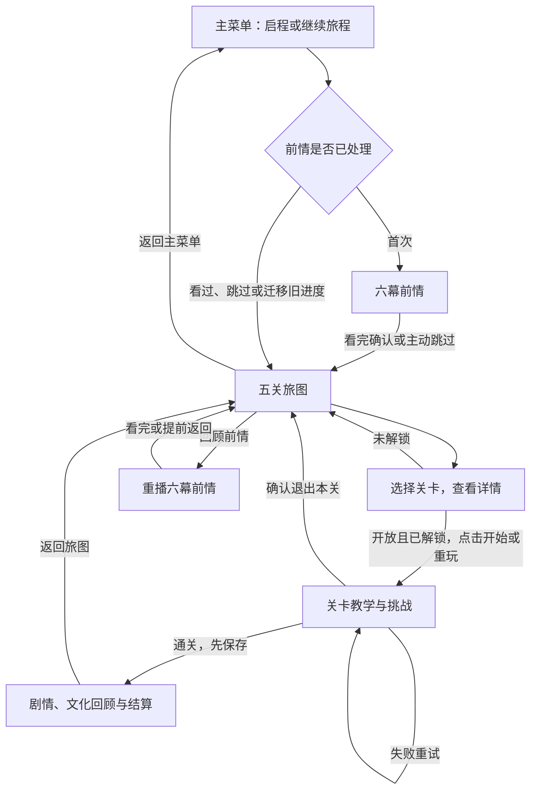

# 五关旅图与前情回顾规格

更新：2026-11-26。本机源码已接入洛阳完整玩法原型：东岭关通关后可进入，完成后盖洛阳章、队伍到第二关出口、右侧显示独立最快路线。后三关仍不可进入；第二关未公开发布，完整实现边界和验证见[洛阳规格现状](chapter-02-luoyang-spec.md#16-当前像素美术与演出整合)。下文早期“仅东岭关／洛阳未开放”的实现记录为此前快照，与本段冲突时以本段为准。

适用范围：整个《关公 · 过五关斩六将》的旅程入口。已有六幕「千里寻兄」是全游戏前情，东岭关是地图上的第一站。现有实现与验证见 [HANDOFF.md](../../HANDOFF.md)；地图现已接入，首次前情先到地图，再由玩家明确开始关卡。

页面精简后的设置入口、锁定详情和按需提示以 [界面层级规格](interface-hierarchy-spec.md) 为准；下文保留旅图流程与进度约定。

## 1. 已确认的决定与本期范围

- 使用有吸引力、能融入旅程的山水像素卷轴地图，五站始终可见。
- 顺序解锁，已通关的关卡可以重玩；选择节点后查看详情，再明确点击出发。
- 首次启程先播放现有前情，结束或主动跳过后进入地图；以后直接进入地图。
- 地图提供「回顾前情」，看完或退出后返回地图，保持选择与旅程进度。
- 本机当前可进入东岭关与满足前置后的洛阳原型；未通过东岭关时洛阳仍以薄雾与前置原因表示不可进入。汜水关、荥阳、黄河渡口继续以淡墨和薄雾表示尚未开放，可以查看原因但不能进入。
- 设计覆盖地图、关卡入口、进度保存、前情返回与结算衔接。其他四关玩法、云存档、跨设备同步、自由选关、地图探索战斗不在本期范围内。

地图不是走到节点才能触发的小游戏。关羽和马车提供旅途位置感，实际操作由可选关卡节点与明确按钮完成。

## 2. 玩家流程



### 首次启程与以后进入

- 保留主菜单明确的开始点击，让玩家主动开启游戏与 Web 声音。未处理前情时主按钮为「启程」；处理过后改为「继续旅程」。主按钮始终进入上述流程，不直接开始战斗。
- 首次前情的最后确认按钮改为「展开旅图」。自然播到最后一幕仍等待确认；确认进入地图时记为已看完，主动跳过记为已跳过。
- 仅仅进入前情、播放几幕或暂停，不写已看完。刷新或关闭后，未处理的首次前情仍可再次播放或跳过。
- 首次看完或跳过后，地图默认选中第一处已开放、已解锁且未通关的关卡；选择本身不触发战斗。
- 以后启程直接进入地图。进入某关、重玩、失败重试、从结算回地图，都不自动重播全游戏前情。
- 回到主菜单不清除旅程记录。本期不增加清空进度按钮，不把「启程」解释成清除存档。

### 地图中的前情回顾

- 「回顾前情」始终可用，位于地图固定工具区，视觉次于关卡的出发按钮。
- 从第一幕开始重播，复用现有旁白、字幕、声音开关、重听、前后翻幕、暂停和失焦规则。
- 回顾末幕的确认按钮及右上提前退出按钮为「返回旅图」。Esc/P 仍进入暂停，不直接关闭回顾。
- 打开前保存地图选中节点、详情内容、键盘焦点及视图位置；返回时恢复，同一会话内不重新播放卷轴首次展开动画。
- 回顾不调用新开局重置，不开始关卡，不更改通关、解锁、成绩或战斗检查点。用户主动改变声音时，仍可保存声音偏好。
- 保留现有文化卡的重看入口作为补充入口；从文化卡打开时返回原文化卡，从地图打开时返回地图。首次入口、地图回顾、文化卡回顾必须显式区分。

## 3. 卷轴的视觉方向

画面主题为「千里寻兄 · 五关旅图」：像打开一张随行的山河长卷，沿着关隘与水路寻找兄长。地图沿用已有连环画的像素质感、山关色调和克制的光影。

### 整体构图

- 在 960×540 逻辑画布内呈现整幅横卷，两端木轴、纸张边缘与轻微卷曲属于同一物体，背景为暗木或深墨绿。卷轴占据主体，四周只留必要操作空间。
- 山脉、道路、城关、寺院、树林和黄河共同绘制在同一张底图中。使用统一俯视斜角、像素密度、建筑比例、光照方向和纸上落点，交界处有自然遮挡与颜色过渡。
- 旅路从左侧山口，经中央城池与林地，通向右侧黄河渡口；用起伏地形形成五站之间的节奏。章节顺序服务叙事，这是文学旅程示意，不画成精确地理导航。
- 地图上的地标需要专门构图，已有五关素材用于身份、形制和配色参考。不能将五张完整关卡背景直接缩成小方图贴到纸上，也不能把独立城门、卷轴、船只悬空叠在图上。
- 保持五处地标与名称可读，后续章节用淡墨与薄雾拉开远近，但不遮掉关名；雾层位于原生关名与选中笔触下方。当前版本不要求拖拽、缩放或水平滚动才能找齐五站。
- 生成美术不包含关名、状态、分数和按钮文字；这些使用 Godot 原生节点绘制，保证可读、可更改和可翻译。

### 地标与兴趣点

| 顺序 | 关卡 | 地图地标 | 旅途氛围与详情短句草稿 |
| --- | --- | --- | --- |
| 1 | 东岭关 | 山口城门、哨旗与石阶，旅路从关门穿过 | 关前受阻：护送二位夫人，闯过第一道关口。 |
| 2 | 洛阳 | 更宽的城墙、楼阁与通城大道 | 古都险途：城楼高耸，前路暗藏危机。 |
| 3 | 汜水关 | 关隘旁的镇国寺、院落和树荫 | 寺前疑云：山寺深处，赴宴之前须辨人心。 |
| 4 | 荥阳 | 暮色城池、驿馆与疏落灯火 | 夜宿危城：灯火之下，护住同行之人。 |
| 5 | 黄河渡口 | 河岸芦苇、渡船与开阔水面，路止于码头 | 渡河北行：越过大河，继续寻兄之路。 |

短句是项目改编草稿，后四站用于建立期待，不在地图直接揭露伏兵位置、解法或完整结局。第五站不画成已经与刘备重逢，以免超出既定关卡结局。

### 色彩、位置与动态

- 最新题记内收：编号／标题／介绍／成绩／限制说明统一左边线x=723，正文仍左对齐，宽174；分隔线为x=723–881。主按钮为x=720–894，保留y=386高度。整体向右约12逻辑像素，避开山水过渡，留出右木轴边距；第一关介绍保持两行。

- 最新位置微调：汜水关在本次上移版基础上左移10／下移8，荥阳右移10／下移8逻辑像素；两者Button左上角最终为(310,297)与(428,190)，名称／点击区／选中笔触同移。

- 2026-11-25文字微调：汜水关／荥阳／黄河渡口整体节点分别上移24／18／26逻辑像素，名称、点击区、选中笔触同移到地标附近浅色空地。右侧成绩用14px淡墨“最佳”与30px深墨楷体数字同行，不加面板；整组仅在东岭关已通关时显示。“开始／再次挑战”及原金笔触从y=408上移至386，名称与介绍保持。

- 五处关名使用24px楷体与暖米色描边；可进入关卡为深墨绿，尚不能进入的关名变淡且地标覆静态纸色薄雾。移除全部节点下的状态字，选中金色笔触仍位于关名下，不增加矩形卡片。右侧保留未开放／前置条件原因，禁用出发按钮；开放配置与前置判断分别执行。

- 纸面用暖米色、旧金色和淡墨山纹；林地为低饱和青绿，城墙为石青，黄河带赭黄。印章用朱砂色，延续游戏的纸色文字与墨绿操作区。
- 关羽与载着二夫人的小马车作为同一比例的队伍，站在已走过旅路的末端。无通关记录时在东岭关前；本期通关后停在东岭关出口，不提前站到未解锁的洛阳。
- 浏览其他节点只改变选中标记与详情，不移动队伍、不增加路线覆盖。队伍位置表达实际进度，不能与鼠标选择混淆。
- 旅路只保留底图原路，不叠加已行进的黄色线或描线动画；移除容易与选中标记混淆的朱红军旗及其呼吸动画。选中关名下仍用不规则金色笔触强调。通关节点只盖朱砂「过」章，复用通关界面印框与厚楷字，下面加柔纸色衬底保证山林上可读，不再写「已通关」。状态同时由印章形状、薄雾、队伍位置和右侧说明表达。队伍整体放大至1.35倍，TravelStart=(112,350)、TravelEnd=(222,305)，两者位于ScrollClip局部坐标，落在关前／关后道路上；逻辑读取TSCN锚点。
- 首次进入地图用约 0.6–0.9 秒的展开与纸张轻响，节点按路线依次显现；控件在展开结束前不接受出发输入。等待动画不是加载进度，不显示百分比。
- 首次通关返回时，用约 0.8–1.2 秒队伍短距离前行与盖章；同一通关只演一次。普通选点过渡约 0.15 秒，不反复卷起整张地图。
- 薄雾与文字保持静止，不加循环呼吸。降低动态模式下直接展开到静态终态，关卡与进度同样清楚。

## 4. 布局与交互

### 画面分区

| 区域 | 960×540 下的布局目标 | 内容 |
| --- | --- | --- |
| 顶部 | x=83起，y=9–61，整行35px，避开左侧木轴 | 「千里寻兄 · 五关旅图」整行同级书法，右上留空 |
| 卷轴主体 | 约 x=24–936，y=80–452 | 左侧约 640 像素宽呈现五站路线，右侧约 240 像素宽留安静纸面写关卡详情；以完整构图为准调整 |
| 详情题记 | 卷轴右侧留白内 | 章节序号、关名、状态、短句、可用成绩与单一主按钮；不遮挡第五站和河道 |
| 固定工具区 | 约 y=470–520 | 返回主菜单、回顾前情、声音、减少动态，及简短操作说明 |

这是一张完整旅图，详情像落在卷边的题记，与纸张颜色和笔触相接；不再套多层厚重面板。主按钮使用现有墨绿底、旧金描边，前后景关系清楚。

### 操作规则

- 每个节点使用真实 Button 与明确点击范围，逻辑点击区至少 44×44，不重叠。关名位于地标旁，关联同一个节点；不重复显示状态标签。
- 点击或键盘切换只预览详情。再次点击节点不直接启动；只有详情区「开始挑战／再次挑战」执行进入关卡。
- 左右方向键按章节顺序选择五站，包含未解锁节点，便于查看整段旅程。Tab 遍历可用控件，Enter 激活当前控件；方向键选完仍需把焦点移到出发按钮或点击按钮才出发。
- 不显示底部“选关／TAB切换／ENTER确认”提示，鼠标或键盘输入均不再触发该文字；上述按键功能及操作指南入口保持。
- 未解锁节点可预览，出发按钮不可用，同时显示原因；不打开空白场景、不用无响应代替说明。
- Enter 回显、快速双击、鼠标与键盘同帧触发不得重复启动。前情返回、关卡退出与地图展开都隔离旧输入，避免一次确认同时关掉动画并进入战斗。
- 地图隐藏战斗 HUD，冻结世界、战斗时钟和战斗输入；保留现有刀形光标的按钮反馈。
- 地图 Esc 返回主菜单；地图没有未保存的战斗会话，不弹清除进度确认。回顾时 Esc/P 沿用前情暂停，不能透传到地图。
- 默认 1280×720 与 960×540 均能完整操作；窄浏览器按现有比例缩放和留黑边，关卡内仍提示桌面键盘。最低尺寸下正文约 16–18、关名约 22–26、次要说明不低于 14 逻辑像素；实际以阅读检查为准。

## 5. 顺序解锁与当前四关未开放状态

「剧情条件」和「内容开放」分别判断。满足剧情条件不代表该关已开发或可进入。

```text
story_unlocked(i) = i 为第一关，或所有前置章节均已通关
enterable(i) = story_unlocked(i) 且该关已开放 且入口资源有效
```

通关事件由实际关卡胜利产生；看介绍、播放前情、跳过前情和点击地图都不能生成通关或解锁进度。

| 节点情况 | 地图与详情文案 | 主按钮 |
| --- | --- | --- |
| 已开放、已解锁、未通关 | 深墨关名、无雾、无通关章 | 开始挑战，可用 |
| 已开放、已通关 | 红色「过」章；右侧展示现有最佳成绩 | 再次挑战，可用 |
| 已开放、前置未完成 | 淡墨与薄雾；右侧如「通关洛阳后开启」 | 尚未解锁，不可用 |
| 未开放、前置未完成 | 淡墨与薄雾；右侧分行写「先通过前一关」「此关尚未开放。」 | 未解锁，不可用 |
| 未开放、前置已完成 | 淡墨与薄雾；右侧分行写「前置已完成」「此关尚未开放。」 | 未解锁，不可用 |
| 本应可玩但入口资源损坏 | 暂不可用，保留其通关与成绩 | 暂不可用，不可用 |

下表描述逻辑状态；地图上不把这些状态逐站写出，使用上述印章／淡墨／薄雾呈现：

| 章节 ID | 关名 | 内容开放 | 初始表现 | 东岭关通关后 |
| --- | --- | --- | --- | --- |
| `dongling` | 东岭关 | 是 | 待挑战 | 已通关，可再次挑战 |
| `luoyang` | 洛阳 | 否 | 未解锁，未满足前置 | 未解锁，已满足前置 |
| `sishui` | 汜水关 | 否 | 未解锁 | 未解锁 |
| `xingyang` | 荥阳 | 否 | 未解锁 | 未解锁 |
| `yellow_river` | 黄河渡口 | 否 | 未解锁 | 未解锁 |

未来某关上线时只变更内容开放与有效入口配置，解锁仍按保存的通关记录计算，不要求已通关玩家重打一遍前置关。

## 6. 进度、重玩与结算返回

- 顶部不显示通关计数；旅程进度由真实通关“过”章与队伍位置呈现。内部仍统计实际通关的不同章节，重复通关不累加，存档／解锁规则保持；不把第一关完成写成整个游戏完成。
- 默认选中最早一处可进入且未通关的章节；若没有，则选中最近一处已通关且可重玩的章节；全新进度选东岭关。若只有未解锁的下一站，仍选可重玩的已完成章节，并显示下一站未解锁的信息。
- 详情仅显示真实记录。本期东岭关展示现有评分版本下的最佳分数，无记录显示「尚无通关记录」。当前未保存最佳时间、星级或评价，不能生成星星或伪造数字；这些数据另行接入后才显示。
- 重玩只初始化所选关卡的新战斗会话，保留所有已有通关与最佳成绩。挑战失败或中途退出不降级通关状态，较低的新成绩不覆盖最佳成绩。
- 通关时先保存，再展示现有结尾对白、可跳过的文化回顾与结算。结算主按钮为「返回旅图」，回地图后反映新进度；不把玩家直接送入下一关。
- 仅首次通关触发队伍前行与盖章，重玩结算返回不重复制造「刚解锁」效果。下一站未开放时提示「东岭关已通过 · 洛阳未解锁」。
- 暂停和失败界面可选择「返回旅图」。本关未结束时确认：「返回旅图后，本次关内进度将丢失；通关记录与最佳成绩会保留。」取消恢复原暂停／失败界面，确认才清除本局临时状态并返回地图。
- 持久进度以关卡为单位。现有孔秀检查点只在本局有效，地图与「继续旅程」不承诺退出或刷新后继续半场 Boss 战；退出后再次挑战从本关起点和现行教学流程开始。
- 声音设置、通关记录与前情处理状态保存于当前设备的现有本地存档；本期不新增账号或跨设备进度。

## 7. 存档与旧记录迁移

继续使用现有 `user://progress.cfg` 的 ConfigFile 机制，不为了地图另建互不关联的浏览器存储。以下字段已经接入，章节通关与评分版本分别保存。

| 区域／字段 | 含义与写入时机 |
| --- | --- |
| `journey/schema_version = 1` | 地图存档版本；与战斗评分版本分开 |
| `journey/intro_state` | `unseen`、`completed`、`skipped` 或 `legacy`；首次明确结束时保存 |
| `chapter.<id>/cleared` | 每个稳定章节 ID 对应一个 ConfigFile 区域，如 `[chapter.dongling]`；成功结算保存，不因新开局复位 |
| 现有 `ch01-v2-checkpoint/best` 与 `cleared` | 迁移时保留第一关当前评分和通关字段；过渡期由同一个保存入口同步维护 |
| 现有 `settings/muted` | 继续复用，不因地图或回顾改成另一份设置 |
| `settings/reduced_motion` | 地图减少动态设置，用户切换时保存 |

- 解锁由通关顺序推导，不把 `unlockedChapter` 当作可无条件进入筹备章节的命令。内容是否开放来自章节配置，不写入个人存档。
- 第一次迁移读取当前有效的第一关通关记录，带入地图与已有最佳成绩；旧评分版本的原记录保留，不混进当前评分。旧存档已有可靠通关记录时，前情状态设为 `legacy`，直接进地图，仍可手动回顾；不谎称已经完整看过动画。
- 没有通关记录、也没有前情记录的旧存档无法推断观看情况，按首次前情处理；仅有静音设置不能作为观看证明。
- 回顾不把 `skipped` 误写成新的通关，不影响路线。保存声音偏好允许独立发生，但不得覆盖其他区域。
- 当前 `main.gd::_save()` 新建 ConfigFile 后仅写成绩与声音，会覆盖未来新增区域。实现时必须改为统一加载、保留原字段、更新目标字段并保存，地图和战斗共用入口；不能让按 M、重玩或结算擦掉前情与章节记录。
- 缺字段用安全默认值；格式损坏、未知版本和非法章节 ID 不导致崩溃或跳关，保留可读旧数据并提示保存／读取问题。读取与迁移只在入口执行，不能每帧迁移。
- 保存失败时在页面明确提示「本次进度未能保存」，保持会话内可玩与正确进度，不显示已经可靠落盘。保存前情失败时本次仍可进地图，但下次可能再次出现前情。
- 测试只使用 `/tmp` 隔离存档或专用浏览器来源，不读取、修改或清空玩家真实存档。迁移测试准备旧结构夹具，不能用玩家文件试迁移。

## 8. Godot 接入规划

| 文件／组件 | 职责 |
| --- | --- |
| `godot/scenes/ui/journey_map.tscn` | 可在 2D 编辑器预览的卷轴底图、五个节点、进度、详情、工具区和展开轨道 |
| `godot/scripts/journey_map.gd` | 呈现节点状态、选择、键鼠导航、地图动画和对外操作事件，不自行判定战斗胜利 |
| `godot/data/chapters.json` | 五站稳定 ID、顺序、关名、短句、内容开放与入口配置；前置按顺序推导，地标与点击锚点保存在 TSCN |
| `godot/scripts/progress_store.gd` | 统一读取、迁移和保存，保护现有评分、设置与新增旅程字段 |
| `godot/scripts/main.gd` | `map` 会话状态、主菜单路由、实际关卡启动、退出与结算返回，保护战斗重置边界 |
| 已有 `prologue.gd`／`prologue.tscn` | 接受明确调用来源，显示相应按钮文案，结束时回到地图或原文化卡 |
| `godot/assets/journey-map/` | 仅放运行所需地图素材、导入参数和来源说明；源素材库保持原样 |

- 章节登记只给东岭关配置有效的可玩入口，后四站不能预加载不存在的场景。现有 `dongling_pass.tscn` 是关卡表现层，不能把它误当作包含完整战斗控制器的独立游戏入口；第一关仍通过主控制器进入现有教学与战斗流程。
- 将「打开旅程入口」「开始所选关卡」「失败重试」分别处理。进入地图、前情回顾和选点不能调用现有 `_start()`／`_reset_run()` 产生战斗副作用。
- 在显示和执行两个位置检查内容开放、前置条件与资源有效性；禁用按钮之外，键盘或程序事件也不能绕过条件。
- 地图退出／回顾切换取消旧 Tween、完成回调和声音，防止过期事件改写新界面。前情同一时刻只有一套实例播放，保留已有 Web 音频开启、静音观看和焦点暂停处理。
- 背景、交互与文字保存在真实 TSCN 节点；轻微雾、水、光效可用 shader 或短动画。替换底图时同步调整锚点及点击区，不能只改图片却沿用失配坐标。
- 新中文文本接入后检查并补齐 `demo-font.ttf` 字符子集，继续保留许可证。新增原生按钮沿用刀形光标反馈与输入隔离。
- 低动态呈现由地图组件提供明确入口。初始化优先使用保存的 `reduced_motion`，没有记录时读取可用的系统偏好，否则默认正常动态。地图内「减少动态」开关即时切换、保存到统一设置，不能改变章节进度。

## 9. 美术制作与实现顺序

1. 先完成章节数据、地图线框、入口与返回、隔离存档迁移；以占位图验证五站状态和输入，不将其当最终美术。
2. 基于现有五关素材制作一张完整卷轴构图，重点验证五站的层次、道路连续性、建筑落点和右侧题记留白。当前使用的完整底图与生成来源已保存在运行素材目录。
3. 接入可选节点、进度表现与地图回顾，保留真实文字；检查所有地标与点击范围一致，再补克制的展开、队伍前行和盖章。
4. 接入东岭关教学、暂停退出、结算返回；后四站保持「未解锁」，验证未来切换开放配置时仍按顺序进入。
5. 完成自动检查、编辑器 2D、原生运行与新 Web 包检查，再更新实现状态和素材来源。所有原图保留，导出与缓存不提交。

## 10. 验收清单

| 情况 | 必须满足 |
| --- | --- |
| 全新存档 | 首次点击启程播放现有六幕，确认或跳过后到地图；不直接进入战斗；进度 0 / 5 |
| 首次前情中断 | 中途暂停、失焦、关闭不误写已看完；明确完成与跳过分别保存，下次直接地图 |
| 原有已通关记录 | 隔离迁移后保留第一关通关、最佳成绩和静音；显示 1 / 5，可重玩，直接进地图 |
| 地图回顾 | 从任意选中节点回顾，末幕或提前返回后恢复同一选择、详情与焦点，进度不变 |
| 文化卡回顾 | 仍返回原菜单／结算的文化卡，不被地图返回逻辑截走 |
| 声音与失焦 | 回顾沿用解锁、静音提示、重听、暂停续播；地图背景声与旁白不重复叠播 |
| 地图节点 | 五站可查看；鼠标选点和方向键选择不启动战斗、不移动旅程队伍；主按钮才启动 |
| 四站筹备 | 通关前后均用淡墨／薄雾表达不可进入，选择后右侧说明原因；洛阳前置已满足也不能开始；键盘、双击与直接动作事件同样受限 |
| 顺序解锁 | 用测试配置模拟后四站开放，只有前置全部完成后才可进入；生产配置仍全部未解锁 |
| 首次通关返回 | 保存后到结算，再返回地图；进度只加一次，通关印与队伍位置正确，下一站筹备状态正确 |
| 已通关重玩 | 成功、失败、退出都不撤销通关；低分不覆盖最佳；不重播首次开篇、不重复新解锁动画 |
| 退出与检查点 | 有确认，取消恢复原界面；确认后丢弃本局临时进度，已有记录保留；新挑战从关卡起点开始 |
| 输入与后台 | 开篇结束、展开、回顾返回和关卡退出的持键／快点均不穿透；地图期间不接受 J/K/L/Space 战斗操作 |
| 存档写入 | 声音、减少动态、回顾、重玩与结算相互不覆盖记录；缺字段与写入失败有安全行为和明确提示 |
| 美术融合 | 卷轴作为完整物体，地标与道路共享透视、纸面和光影；无悬空贴图、厚面板遮路或烧进图片的动态文字 |
| 可读性与动态 | 五站及状态在 960×540、1280×720、窄浏览器留边时可读；减少动态下不用等待演出，节点仍可辨认 |
| 工程检查 | 新增地图／迁移回归，更新原有前情入口与结算断言；Godot 导入、相关旧检查、2D 编辑器与实际运行通过 |
| Web 交付 | 重新导出后检查当前包，验证首次、回顾、旧记录、声音与刷新；不得用旧缓存包或玩家真实存档证明通过 |

## 11. 实现与本机验证记录

- 已接入完整卷轴地图、五站详情、顺序前置、四关筹备限制、首次前情到地图、地图与文化卡各自回顾返回、通关重玩和退出确认；已有六幕与中文配音直接复用。
- 地图锚点在 TSCN 中编辑，不将像素位置写死在逻辑里。卷轴展开约0.8秒，队伍前行与印章提供少量动态；减少动态可直接显示终态。节点详情即时切换，未增加单独的详情淡入；本期没有水面或雾层循环。
- ConfigFile 统一保存、旧第一关迁移、当前评分版本保留与失败提示已接入。原生使用临时存档，Web 用独立来源验证；没有清除玩家真实进度。
- 原始地图接入时六组自动检查共235项通过，Godot 导入与 Web 导出通过；检查实际原生画面、编辑器 2D，以及应用内浏览器的进入、回顾、刷新、教学和确认返回。源码与素材说明已更新，未提交或公开发布。
- 后四关仍无可玩实现；Safari 新地图专项、长时间运行、三位陌生玩家的理解与地图可读性反馈待后续验收。

### 2026-11-25 标记精简与位置调整

- 通关复用胜利印框与「过」字，移除节点状态字和红旗；未开放地标静态纸雾、关名淡墨，选中仍用金色笔触；队伍放大并改到道路锚点，浏览不改变实际位置。右侧不可进入说明固定两行，避免句号单独折行。原底图、解锁规则和存档结构保持。
- 地图50、场景42、基础27、进度21、UI流程25，共165项隔离检查通过；最后说明断行后地图50项复跑。初次地图检查退出时出现资源泄漏提示，正常导入后复跑完整输出无error／warning，不把初次输出计为干净通过。
- 已检查编辑器2D真实雾层／队伍／印章，以及原生0／1关、洛阳／渡口预览；独立18947网页检查选点、禁止进入、设置返回，控制台无error／warn。正常／临时Web最终导出已更新；未进行真人整关通关或Safari专项，未使用真实玩家存档，未提交／推送／公开发布。

### 2026-11-25 顶部标题放大与计数移除

用户明确选择“千里寻兄 · 五关旅图”整行放大：Title字号27→35（约30%），保留共享书法字体、字重、暖纸色与x=83左边线；上下边界调至9–61以容纳字形，不拆主副题。移除右上Progress节点及文字赋值，保持右上留白；地图章、队伍、成绩及所有通关／存档规则保持。
