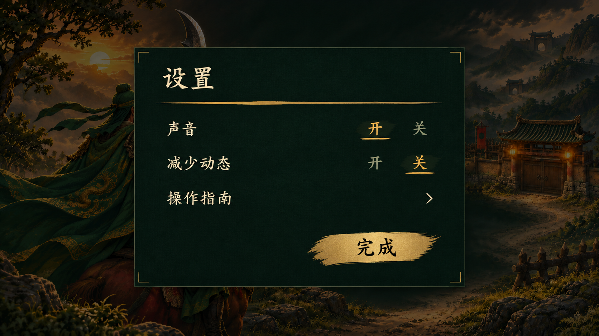

# 全游戏设计语言：克制、沉稳的武侠风

更新：2026-11-23。
状态：用户已确认效果图并授权实施。本轮已将现有游戏页面接入共享主题，并按用户最新截图更换可编辑字体；最新字重按用户确认的较厚版本统一，逐页状态见第 12 节。概念图仍是视觉依据，不是运行截图。

## 1. 目标与适用范围

以「墨绿绢底、旧金笔触、行楷题字、宋体正文」建立一致的游戏语言，延续已实现的赤兔征途首页、山水卷轴和六幕连环画。让操作轻而清楚，把气势留给人物、山水和主要标题。

覆盖首页、旅图、设置、操作指南、暂停、确认、失败、结算、前情控件和文化阅读；战斗 HUD 使用同一套文字与状态色，但保持轻量。章节内容、解锁、战斗、评分、存档及叙事流程沿用现行规格。

本文定义现有界面的视觉系统；现有功能与信息层级仍以 [界面层级规格](interface-hierarchy-spec.md) 为准。新的视觉方案不能被记为已经接入或上线。

## 2. 基本规则

- Avoid unnecessary secondary labels and descriptions. Let the layout do the explaining.
- 一个页面保留一个主要动作；用位置、留白和字号表达主次，不为每个区域再加说明标签。
- 小范围使用笔触、织纹与金属色。普通设置行没有独立厚边框；不为每个控件加龙纹、卷轴端头或闪光。
- 短标题有笔锋，正文重阅读；不把所有文字都改成大幅飞白书法。
- 鼠标、键盘、减少动态和静音都属于组件本身的状态，同步设计。
- 状态不能只靠颜色区分：同时提供位置、下划线、文字或印记。

## 3. 色彩角色

以下十六进制值为 sRGB 基础色。背景取样与透明合成后仍需实机检查，不能只凭色卡宣称对比度达标。

| Token | 色值 | 职责 |
| --- | --- | --- |
| ink | #0D1B17 | 面板实底、字后暗部 |
| jade | #20392F | 面板局部层次、控件低调底色 |
| paper | #EEE2C3 | 深底主要文字 |
| gold | #C7A15A | 可操作文字、选中笔触、焦点 |
| gold_light | #E8CA83 | 悬停、当前焦点或确认瞬间 |
| muted | #A8AE97 | 次要文字、未选中状态；不用于必须阅读的正文 |
| cinnabar | #A74632 | 危险、退出损失、重要印记；不作普通设置选中底色 |

长正文：深底用 paper，纸底用 ink。旧金只用在短文字或标记，不整段铺金。禁用状态降低装饰和饱和度，但「未解锁」与具体原因仍须可读。错误保留文字与明显标记，朱砂不单独承担提示。

## 4. 字体与字阶

运行界面只使用楷书与宋体两套中文字体；首页「关公」透明书法标识为已有独立美术资源。

| 层级 | 字体方向 | 960×540 逻辑画布中的建议值 |
| --- | --- | --- |
| 首页标识 | 沿用已实现的飞白标题图片 | 保持现行构图 |
| 面板／章节标题 | FandolKai Regular＋统一中等增重，保留尖收笔 | 32–44 px，设置页 44 px |
| 主要动作 | FandolKai Regular＋统一中等增重 | 24–34 px，设置页完成按钮 34 px |
| 普通动作／设置项 | FandolKai Regular＋统一中等增重 | 22–28px；地图／前情紧凑操作 20px，HUD 16px；设置页 28px |
| 正文／字幕 | Noto Serif SC Regular 400 | 正文 18px，前情字幕保留 22px，按内容换行 |
| 状态／数字／必要提示 | Noto Serif SC | 16–18 px，避免小号细笔画 |

字体来源：[Fandol 的 CTAN 原始包](https://ctan.org/tex-archive/fonts/fandol)与 [Noto Serif SC](https://github.com/google/fonts/tree/main/ofl/notoserifsc)。按用户 2026-11-23 的反馈，原 Ma Shan Zheng 的圆润笔意改为更接近所选图的尖收笔楷书。FandolKai 使用未改动的原 OTF，保留 GPL 与字体嵌入例外、原版权及上游 README；宋体固定 400 字重并重建全游戏运行文字子集，保留 OFL。当前两套字库覆盖运行文案的 402 个汉字。生成图中的笔迹不是可恢复的“旧字库”，因此不声称与图中字形完全相同；美术中的书法、印记和嵌入文字沿用原图。

- 按用户本轮确认，标题、按钮、设置项及原有楷书题字层级统一引用 `themes/wuxia-display-font.tres`，使用 Godot `FontVariation.variation_embolden = 0.45` 适度增重；这是渲染设置，原 OTF 字节不改。对照 0／0.4／0.7／1.0／1.3 的真实设置页后选取中等值，不使用粗描边或拉伸字形。
- 正文、字幕、数字、场景提示和键帽的宋体仍为 400，不随展示字一起增重。
- 按钮必须留足完整中文，不能靠截断或省略号解决布局。
- 继续旅程、保存失败和较长文化段落都要检查，不能只检查「设置」两字。
- 数字保持清晰稳定；HUD 体力、义气、幕数、评分的辨识度优先。
- 图像生成的字形只是风格预览，不等于真实字体排版。落地以真实字库与字形检查为准。

## 5. 材质与面板

| 场景 | 主要材质 | 强调方式 |
| --- | --- | --- |
| 设置／暂停／确认 | 深墨绿绢本 | 短金笔触、少量边角刻线 |
| 地图／故事阅读 | 暖纸与墨迹 | 深墨文字、旧金路径、朱砂印记 |
| 战斗 HUD | 轻量半透明暗部 | 清晰文字、资源色与必要警示 |
| 结算 | 墨绿底与印记 | 结果标题、成绩、一个返回主动作 |

设置类面板底色约 94–97% 不透明，避免底图的字和高光穿入正文；细织纹强度约 2–4%，只在近看时可辨。不增加模糊发光、大投影或连续厚金框。允许 1px 低对比轮廓与少量短角线；圆角 0–3 px。面板外遮罩现统一为 55%（原建议范围 45–55%），保留背景中的人物与城门轮廓。

内容使用 8px 间距节奏，面板内边距约 32–40px。优先收紧空白和理顺对齐，再决定是否增加分隔线。

## 6. 通用动作组件

### 主操作

仅用于出发、继续、完成等当前主要动作。文字配旧金的横向自然笔触；点击范围保持稳定矩形，笔触边缘只负责视觉。暖纸或旧金底上的文字为深墨色。设置页「完成」为 208×56px，文字 34px；避免亮黄塑料感、胶囊圆角和闪烁光晕。

### 次操作与入口

如操作指南、故事与文化、返回：文字为主，短笔触或细线承托；通常没有常驻实心矩形背景。行入口可用一个克制的右向标记，不加「点击进入」之类重复说明。常规菜单命中高度至少 44px；战斗 HUD 的三个紧凑工具按钮保留 30px，使用局部暗底保证可读。

### 状态

| 状态 | 视觉 | 动效／声音 |
| --- | --- | --- |
| 默认 | paper 文字、低调短线；主动作保留旧金 | 静止、无持续音 |
| 悬停 | 字色略暖，局部淡金笔触显现 | 100–140ms 淡入；只在进入时播一次短音 |
| 键盘焦点 | 与悬停同等可见的金笔触，位置与文字都明确 | 不用白色粗矩形；移动焦点可播同一短音 |
| 按下 | 笔触加深，文字可轻沉 1px，命中框不动 | 60–90ms；一次确认音 |
| 禁用 | 移除动态与明亮笔触，保留可读状态字 | 不播放悬停或确认音 |

鼠标进入可同步焦点；键盘切换后清除旧选中背景。淡出允许过渡，但稳定后只保留一个焦点背景。减少动态开启时直接到最终状态，不下沉、不淡入，不改变可用性。

沿用首页已有两段原创短音，建议先保持悬停 -12dB、确认 -10dB，通过实机听感再调。共用次动作笔触悬停／焦点透明度 0.16、按下 0.24，按下文字使用较亮暖纸，避免笔触提亮后字色对比不足。75ms 内鼠标与焦点事件去重；仅菜单反馈使用此规则，不节流真正操作。全局静音即时停止反馈，失焦及遮盖时不发声；网页首次受自动播放限制时需真实用户手势解锁，不新增永久提示标签。

## 7. 设置页视觉样板

### 7.1 内容与示例状态

效果图只包含下列界面文字：

- 标题：设置。
- 第一行：声音；右侧「开」「关」，示例选中「开」。
- 第二行：减少动态；右侧「开」「关」，示例选中「关」。
- 第三行：操作指南；右端一个进入标记。
- 底部主动作：完成。

不增加副标题、说明段落、英文标签、版本号、默认设置、应用、更改已保存或关闭图标。正常状态不重复「声音：开」。保存失败时必须额外出现清楚的正文反馈，这属于异常状态，不放进正常效果图。

### 7.2 几何布局

固定 960×540 逻辑画布，概念图为 1672×941，实机等比呈现，四边保留完整游戏画面，无截图黑边。

| 区域 | 逻辑范围 x / y / w / h |
| --- | --- |
| 居中面板 | 215 / 77 / 530 / 384 |
| 标题 | 面板内 48 / 24 / 442 / 44 |
| 标题下轻笔触 | 面板内 40 / 86 / 450 / 4 |
| 声音行 | 面板内 52 / 104 / 440 / 44 |
| 减少动态行 | 面板内 52 / 160 / 440 / 44 |
| 操作指南行 | 面板内 52 / 216 / 440 / 44 |
| 完成 | 面板内 280 / 296 / 208 / 56 |

设置名称统一左对齐，右侧开关组宽 136px，每个选项宽 64px，中间留 8px。选中项以旧金文字和短下划线表示，未选中项用 muted；没有现代滑动胶囊或整行大按钮。控制组内仍有清楚的点击区域，不能只点到字的笔画。

这张样板使用赤兔征途背景，整体压暗；面板与文字是视觉焦点。背景中的关羽与右侧城楼仍能辨认，不在面板上再贴人物、卷轴或装饰道具。

### 7.3 行为约定

- 偏好沿用即时保存；「完成」关闭面板，不承担额外应用步骤。
- 点击「开」或「关」明确设置该值；重复点当前值不反转、不重复保存或连响。
- Tab／Shift+Tab 依次经过声音组、减少动态组、操作指南、完成。每组当前选项是唯一 Tab 停靠点；左右键选择开／关，Enter／Space 切换当前组。上下键在四个组间移动；开关内部左右键不触发底层地图。
- 操作指南替换当前设置内容，不叠加第二张重框面板；返回设置时恢复原焦点和开关状态。
- Esc 关闭当前面板并恢复来源焦点；按键不穿透到启程或攻击，关闭后隔离旧输入。
- 设置可从首页、地图或暂停打开。战斗查看指南仍先暂停，关闭后留在暂停页，由玩家继续。
- 静音开关、减少动态、首次观看及关卡进度继续共用现有存档，不能重置旧记录；保存失败保留必要提示。

## 8. 向其他页面延展

- 暂停：行楷标题、继续前行主动作、设置与返回次动作；退出丢失本局状态的说明仅出现在确认页。
- 指南：保留 17 枚键帽与已有演示顺序；新字阶与金色状态统一，键盘字母／符号强调清晰，不为每个按键加纹样。完整指南本身是独立面板，可使用更宽布局。
- 地图：保留卷轴、朱红军旗和金色选中笔触；关名与纸底正文采用 ink，未解锁原因继续可见。
- 前情／文化：字幕、旁白、暂停与回顾功能保持；长文本采用宋体，画面留给连环画，按钮遵循新的主次关系。
- 失败／结算：结果标题、当前可用重试或返回、按需战绩；危险朱砂只用于损失确认，不能把失败页所有按钮都变红。
- HUD：复用正文／数字和状态规则，实际对比度不足时加局部暗底，不将所有信息装进绢本卡片。

## 9. 后续 Godot 落地建议

已建立 `themes/wuxia-game.tres` 与 `wuxia-panel.tres`：统一字体、色彩、绢面、主／次动作、危险动作、地图节点、HUD 和设置组的 Theme variation；布局与原生节点继续保存在 TSCN。首页与设置保留各自已有的细节动效，其余页面由 `wuxia_feedback.gd` 统一音效与 120ms 淡笔触。复用已有金刷、绢面和旅图空白纸纹，不覆盖原画；`wuxia.tres` 保留为上一版兼容资源，当前设置已改用共享 Theme。

所有可操作项保持真实 Button／ButtonGroup 与可访问焦点；背景和标题用独立 TextureRect，不能将概念图整体当成可点击界面。一次只保留一层模态遮罩；按钮状态与声音经共享控制处理，避免每页各写一套。

建议实施顺序：设置页和共享主题 → 暂停／确认 → 指南 → 文化／前情控件／结算 → 地图与 HUD 的必要统一。本轮已完成现有页面迁移；这段顺序保留为后续新页面的接入建议。

## 10. 视觉与功能验收

- 对照样板检查全图及标题／开关／完成局部：字形、对齐、材质、笔触、色彩与留白；不将生成文字当成真实字体证据。
- 正文与交互文字实际合成对比度目标 4.5:1；必要非文字选中标记目标 3:1，旧金不达标时用 gold_light。选中同时有短线／位置，禁用状态仍可读。不据概念图宣称辅助技术合规。
- 检查实际最小桌面 960×540 与放大窗口；固定比例缩放与黑边内不裁切、不产生误点击，不据此宣称手机触控适配。
- 验证鼠标文字与留白命中、键盘循环、开关幂等、按键重复、模态穿透、焦点恢复、网页音频解锁、静音及失焦。
- 验证减少动态无位移动效、隐藏页不继续演示、正文不缺字；用隔离存档验证现有偏好、回访玩家和保存失败。
- Godot 导入、相关自动检查、编辑器 2D、实际运行与 Web 导出按真实修改范围执行；本轮已按实际实现运行检查，具体证据和验收边界见第 12 节。

## 11. 交付物与待确认点

实际生成图片为 1672×941，保持约 16:9 构图；960×540 的表格坐标是后续真实布局基准，图片中的笔迹与细部几何为概念示意，不承诺逐像素复刻。原始设置截图保存在 `docs/art/wuxia-settings-before.png`。

- 本规格：`docs/design/wuxia-design-language-spec.md`。
- 设置页效果图：`docs/art/wuxia-settings-concept.png`，内置 image_gen 生成，仅作视觉样板。
- 提示与来源：`docs/art/wuxia-settings-concept-creation.json`。

用户已认可样板。设置页使用真实可编辑文字和分组按钮；字体已按最新反馈改为中等增重 FandolKai／Noto Serif SC 400；许可与来源见 `godot/assets/ui/SOURCES.md`。首轮对照发现字号和完成笔刷偏小，现已按图调整面板比例与字阶，上表记录最终坐标。全图／局部对照和验收见根 `design-qa.md`；此前全游戏迁移报告保留在 `docs/design/game-language-design-qa.md`；现有页面的最新落地状态见下表。

## 12. 全游戏落地清单 · 2026-11-23

| 页面／区域 | 当前实现 |
| --- | --- |
| 首页 | 飞白关公图片与背景不变；可编辑副题、菜单和引子改为尖收笔楷书，保留已有悬停与音效。 |
| 设置 | 原生分组开关、字体、金刷、即时保存与幂等保持，现使用共享 Theme 的设置专用 variation。 |
| 操作指南 | 墨绿绢面、楷书标题、宋体说明、笔刷完成／文字返回；17 枚键帽与原演示时序保持。 |
| 暂停／退出确认 | 绢面与金刷主操作，次操作不常驻方框；退出损失文字保留，危险返回用朱砂色。初始焦点在安全选择。 |
| 失败／结算 | 结果题字、重试／返回主动作、文字次动作与按需战绩统一；检查点条件和保存错误保留。 |
| 文化 | 复用旅图的空白暖纸纹、深墨宋体正文与楷书题字，按句意分段，返回主动作与前情入口分明。 |
| 五关旅图 | 卷轴、军旗、选中金笔触与开放条件不变；关名／操作楷体、描述／状态宋体，出发改金刷。隔着 Node2D 的关卡按钮显式引用主题，保持无方框。 |
| 前情 | 六幅完整连环画、旁白不改；标题／动作楷体、字幕／数字宋体，44px 菜单命中、金刷继续与统一短音。Enter 确认当前焦点，默认仍继续本幕流程。 |
| 战斗 HUD／场景提示 | 保留轻量暗底和资源色，文字／数字使用宋体，短动作楷体；场景标签、人物提示、伤害浮字一并换成阅读字体。 |
| 共同行为 | 静音即时止声、失焦／隐藏／禁用不响，75ms 悬停去重，减少动态直接呈现；弹窗焦点封闭，设置／指南替换来源弹窗，只留一层遮罩。 |

上一轮全游戏迁移完成 338 项隔离检查，字重调整另有 186 项检查；记录保留在历史报告。本轮补齐下方三项收尾并完成 218 项相关检查，最终证据见根 `design-qa.md`。当前已实现并本机验证，随本次提交纳入本地main，未推送／发布。用户明确排除兼容性与长时间运行：Safari、触屏、屏幕阅读器及持续运行不再列为本轮待办，也不据此作兼容或辅助技术合规声明。其他四关的内容开发不属于本视觉规格的迁移任务。

## 13. 本轮收尾 · 已完成

- **遮罩**：设置、指南、暂停、退出确认、失败、结算和文化均采用55%单层遮罩；移除指南82%和其他弹窗76%的旧值，输入拦截与焦点恢复保持。
- **通关印记**：结算题字右侧使用朱红印泥“过”章，68×68px，轻微倾斜。章框是透明纹理，中央42px文字仍为真实Label，不新增副标题，不暗示五关全剧完结；结果标题仍独立表达已通关。静态呈现，减少动态时没有额外盖章动画。
- **实际对比度**：使用原生截图、文字掩码及去字背景进行sRGB合成测量；288项必要文字采样最低4.8105:1，15项选中下划线／地图标记采样最低4.8838:1，分别达到4.5与3的目标；禁用与重复装饰章字4项单列。范围是本轮26个稳定状态，不宣称所有动画瞬间或完整WCAG合规。
- **修正**：前情上方渐隐衬底覆盖标题／人物关系说明后平滑回到原画；声音提示移入字幕暗底，HUD关名补局部暗描边，地图进度提亮。前情“继续 ENTER”扩为226×44、更多入口为64×44且互不重叠，失败重试扩为390×44，文字离开笔刷透明尖端。
- **最小窗口**：960×540原生各页、六幕、错误与展开战绩已实际检查；网页按DOM确认内容区960×540，点击留白、指南返回、前情继续／跳过与地图入口按本轮证据记录。复现工具为 `tools/capture_ui_visual_audit.gd` 和 `tools/audit_ui_contrast.py`；兼容性及长时间运行按用户决定排除。

## 14. 首页制作人员 · 本机实现

首页菜单扩为启程／继续旅程、故事与文化、设置与操作、制作人员四项；菜单整体略上移，以避开较亮的地面。制作人员复用共享墨绿绢面、44px楷书标题、宋体正文、旧金返回笔刷和55%单层遮罩，背景保留、原菜单文字暂隐。长团队名23px自然换为两行，不作滚动字幕；真实 Label／Button 与布局位于 `credits_panel.tscn`。文案与后续署名扩充见 [制作人员规格](credits-spec.md)。

## 15. 东岭关战斗HUD · 朱红笔触方向

用户选中第二张战斗概念图。第一关改为连续朱红气血、玉牌“关”、四枚旧金义气与L键帽，底部居中孔秀金色血条，右上轻量操作入口；保留当前人物与场景原图、原生字体和战斗规则。独立 `combat_hud.tscn` 保存真实节点与布局，数值、暂停与重试同步见 [战斗界面规格](combat-hud-spec.md)。重要战斗提示保留，Boss登场的重复目标和说明收起。旧报告中的绿色细血条是此前状态。

用户随后授权并已实现三屏横向道路分层，见 [道路分层规格](dongling-ground-layout-plan.md)：远景20%视差，城门／墙体世界固定，连续土路与后路肩、低矮前景分别组织；关名与操作补局部墨衬。角色出生点与战斗脚底保持，茶摊移到后路肩，敌人冲刺与主角共用道路边界。
